# 🏗️ mdWebview — Architecture Reference

> **目的**：讓 AI 模型與開發者在 **不需要通讀 26,500 行程式碼** 的情況下，快速理解整個系統的架構、資料流與關鍵設計決策。
>
> 版本：v3.12.9 | 最後更新：2026-10

---

## 目錄

1. [系統架構總覽](#1-系統架構總覽)
2. [請求路由決策樹](#2-請求路由決策樹)
   - [2.1 Sitemap 防抖與 Stale-While-Revalidate 機制](#21-sitemap-防抖與-stale-while-revalidate-機制)
3. [資料流：頁面載入](#3-資料流頁面載入)
4. [資料流：大型檔案虛擬化](#4-資料流大型檔案虛擬化)
5. [資料流：全文搜尋](#5-資料流全文搜尋)
   - [5.1 辭典全文搜尋：游標分頁模型](#51-辭典全文搜尋游標分頁模型)
   - [5.2 已知限制：辭典詞條邊界造成多詞鄰近查詢漏失](#52-已知限制辭典詞條邊界造成多詞鄰近查詢漏失)
   - [5.3 字組比對：簡繁變體互相命中](#53-字組比對簡繁變體互相命中v3110)
6. [公告彈窗顯示邏輯](#6-公告彈窗顯示邏輯)
7. [使用者偏好與排版控制](#7-使用者偏好與排版控制)
   - [7.1 集中式常數池與安全儲存封裝](#71-集中式常數池與安全儲存封裝)
   - [7.2 偏好備份與還原機制](#72-偏好備份與還原機制)
   - [7.3 簡繁字形一併比對依瀏覽器語言自動啟用](#73-簡繁字形一併比對依瀏覽器語言自動啟用v3103)
   - [7.4 繁／簡顯示切換](#74-繁簡顯示切換v3107)
8. [後端模組架構與 API 路由索引](#8-後端模組架構與-api-路由索引)
   - [8.1 lib/ 原生模組職責劃分](#81-lib-原生模組職責劃分)
   - [8.2 server.js 段落分區表](#82-serverjs-段落分區表section-map)
   - [8.3 server.js API 路由索引表](#83-serverjs-api-路由索引表)
9. [app.js 前端架構與 State 物件說明](#9-appjs-前端架構與-state-物件說明)
   - [9.1 段落索引與通用 Helper](#91-段落索引與通用-helper)
   - [9.2 State 物件欄位一覽](#92-state-物件欄位一覽)
10. [config.json 設定欄位一覽](#10-configjson-設定欄位一覽)
11. [關鍵常數速查](#11-關鍵常數速查)
12. [Worker Thread 架構](#12-worker-thread-架構)
13. [安全性設計](#13-安全性設計)
14. [CI/CD 與自動化維護工作流程](#14-cicd-與自動化維護工作流程)
15. [前端高並發與競態防護設計](#15-前端高並發與競態防護設計)
16. [CSS 樣式系統與響應式斷點設計](#16-css-樣式系統與響應式斷點設計)
    - [16.4 首頁垂直溢出防護](#164-首頁垂直溢出防護v3102)
17. [PWA 安裝引導](#17-pwa-安裝引導v3101)
18. [為何 app.js / server.js 不做模組化重構](#18-為何-appjs-serverjs-不做模組化重構)
19. [使用者帳號](#19-使用者帳號v3122)

---

## 1. 系統架構總覽

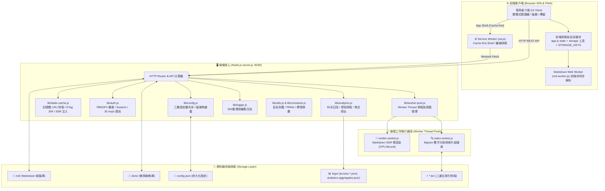

**核心設計原則：**
- **原生 CommonJS 模組化**：`server.js` 為乾淨路由入口，職責解耦至 `lib/` 模組（無 Express/第三方依賴）
- **雙 Worker Thread Pool**：CPU 密集型工作（Markdown 渲染、Bigram 倒排索引）透過獨立 Worker Thread 池並行處理，主事件迴圈零阻塞
- **全非同步 I/O**：所有磁碟存取與 Worker 呼叫均採用 Promise-based async/await
- **零外部 CDN**：所有前端依賴（marked.js、KaTeX、Pele（Mermaid 語法圖表）、字型）均本地託管於專案內
- **集中防禦性儲存**：前端全面透過 `STORAGE_KEYS` 常數池與 `storage` 安全防拋錯物件管理 `localStorage`

---

## 2. 請求路由決策樹

`server.js` 的主路由分發器依序判斷每個請求：

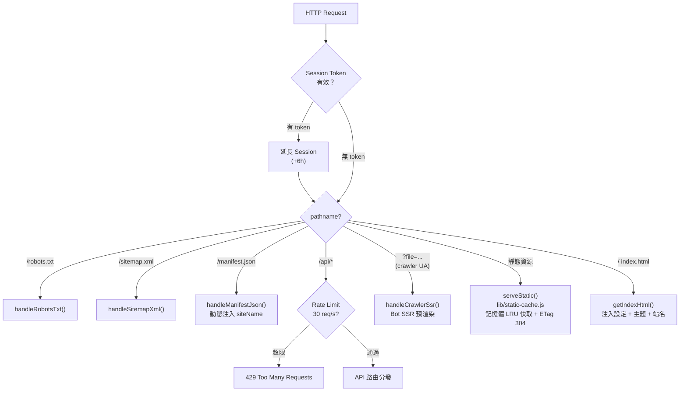

**Bot 偵測**：符合 `CRAWLER_UA_REGEX` 的 User-Agent 或帶有 `?ssr=1` 參數的請求，自動觸發 SSR 預渲染，回傳完整 HTML（含 schema.org JSON-LD）供搜尋引擎索引。

### 2.1 Sitemap 防抖與 Stale-While-Revalidate 機制

為防止大量 Markdown 檔案寫入或同步時（如批次上傳數千篇經論）造成伺服器頻繁重新掃描磁碟建立 Sitemap，引發 CPU 與磁碟 I/O 尖峰，系統採用**沉降防抖 + Stale-While-Revalidate** 快取架構：

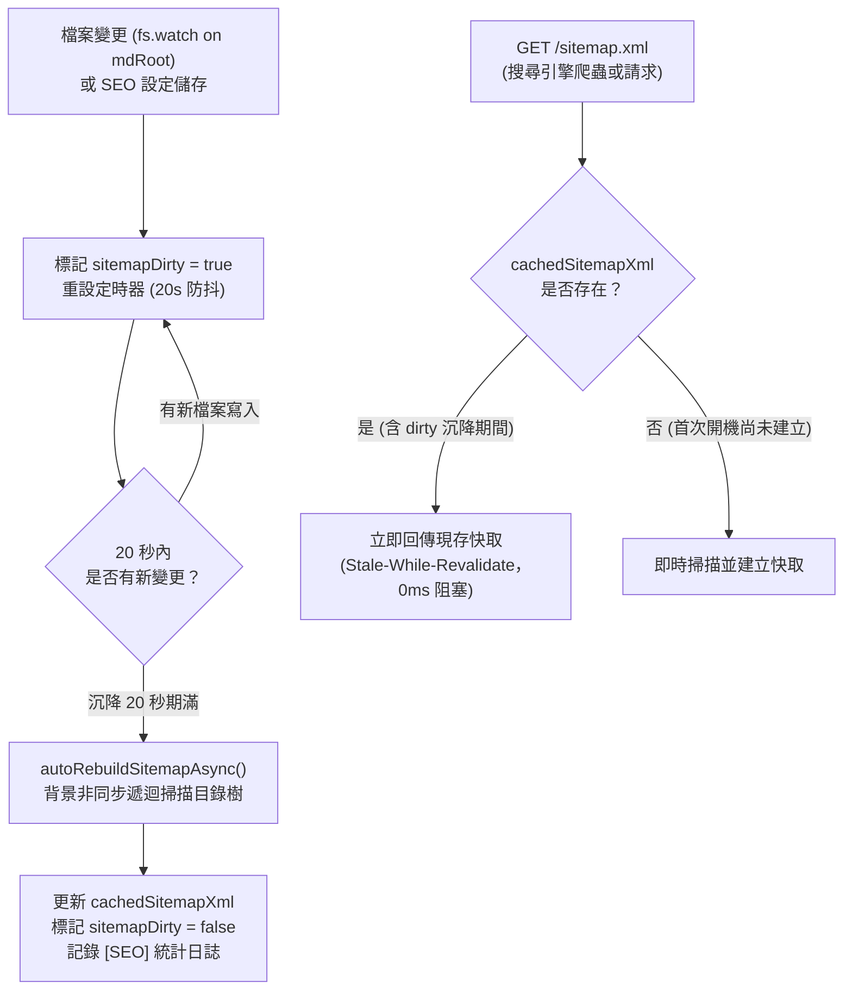

- **20 秒沉降防抖（Debounce）**：任何檔案變動皆重設計時器，直到連續 20 秒無新寫入才執行一次性重建，避免短時間內幾百次寫入觸發幾百次目錄樹遞迴掃描。
- **Stale-While-Revalidate**：即便標記為 dirty，外部請求依然立即可取得現有快取（200 OK 或 304 Not Modified），完全不卡頓伺服器執行緒與網路連線。
- **開機背景預熱**：伺服器啟動時，立即與 Bigram 搜尋索引同步非同步預先暖機建置 Sitemap 快取。
- **結構化日誌**：記錄每次生成耗時、檔案總數與 XML 位元組大小（`[SEO] Sitemap rebuilt: N URLs (X KB) in Yms`）。

---

## 3. 資料流：頁面載入

### 一般使用者（SPA）

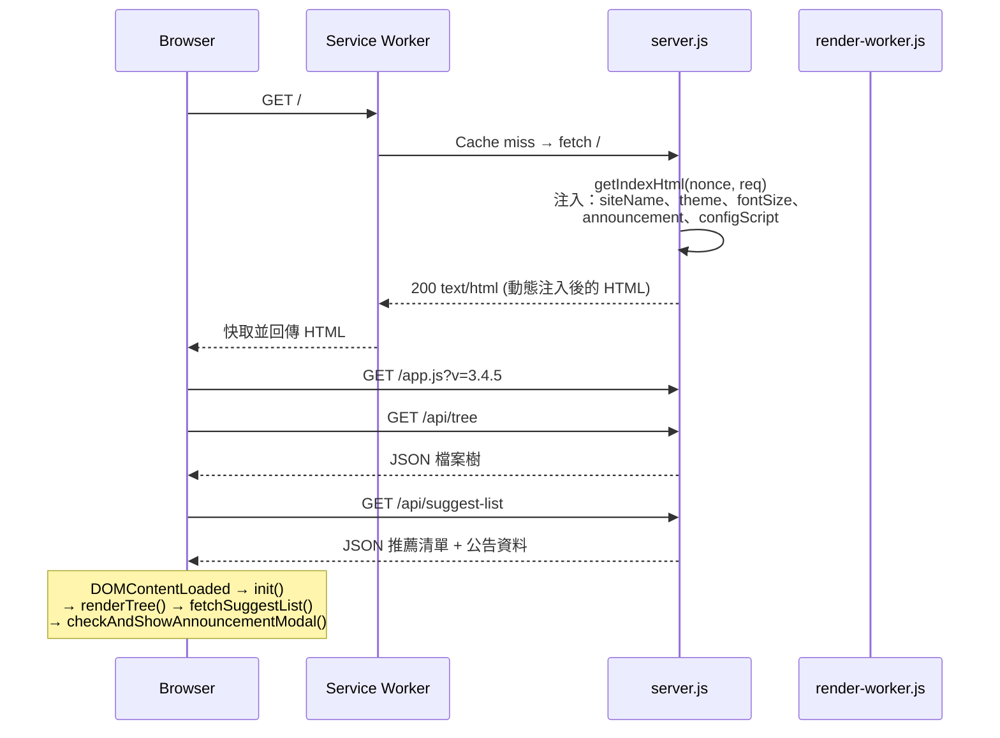

### 搜尋引擎爬蟲（SSR）

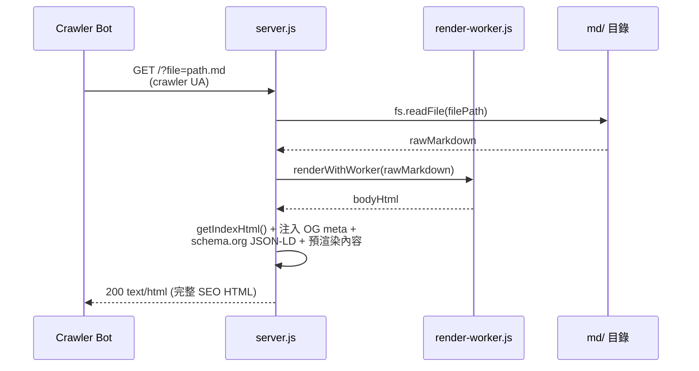

---

## 4. 資料流：大型檔案虛擬化

檔案大小 ≥ **1MB** (`LARGE_FILE_MIN_BYTES`) 時，啟動虛擬化渲染模式：

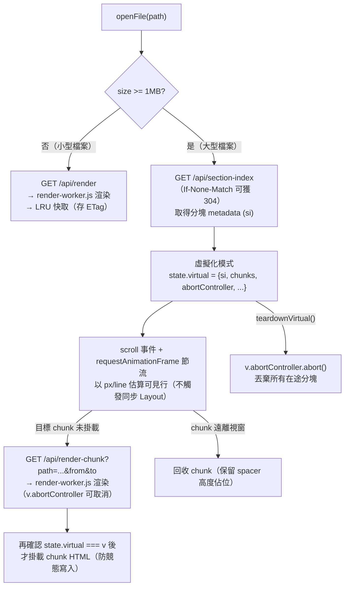

**小型檔案重新驗證（`/api/render`）**：前端不再直接回傳 LRU 快取，而是先送出帶 `If-None-Match` 的條件式請求；伺服器回 `304` 才掛載快取 HTML，回 `200` 則以最新內容取代快取。若 ETag 仍在但快取本體已被淘汰，則清除該 ETag 後改以無條件請求重試。

**section-index 格式**（由 `index-worker.js` 建立）：
- 每個 "entry"（如辭典詞條）的起止行號與位元組偏移
- 用於辭典條目導航（`entryNav` prev/next）與精確分塊邊界

**虛擬化判定（`isVirtualizedFile(filePath)`，~L1968）**：一律以 `String(filePath).startsWith('dict:')` 為真，否則再比較 `(state.fileSizes.get(filePath) || 0) >= LARGE_FILE_MIN_BYTES`。此 Helper 存在的理由是：**辭典檔（`dict:`）永遠走虛擬分塊路徑，但它們並不在主樹的 `state.fileSizes` 對照表中**（`/api/tree` 不含任何 `dict:` 節點——實測 7,598 個檔案節點、0 個 dict 節點）。因此單憑檔案大小判斷會把辭典檔誤判為一般檔案，讓 `restoreReadProgress()` 補送延遲的絕對 `content.scrollTo`，覆蓋掉 `openFile` 剛完成的逐行定位。凡需判斷「這是不是虛擬檔案」處都應走此 Helper。

**深度跳轉定位對齊（v3.7.6）**：`scrollToLine`（~L995）與 `scrollToLineVirtual`（~L2338）過去以 `hlRes.firstMark`（寬鬆模式多區塊高亮視窗中的**第一個** highlight）作為 `scrollTarget`，可能距要求行甚遠，導致跳轉落在錯誤偏移（實測切換檔案後最大偏差 +371,784 px；非虛擬路徑亦曾偏差 +528 px）。現行兩者皆以 `target`（即要求行號對應的 anchor 元素）為 `scrollTarget`。`scrollToLineVirtual` 另加一段**有界自我修正對齊迴圈**（最多 4 次嘗試）：量測 `target.getBoundingClientRect().top - #content.getBoundingClientRect().top - 12` 並重新捲動，直到誤差 ≤ 2 px，若無進展即中止。該迴圈受 `state.virtual !== v`、`jumpToken = state._openToken` 快照與 `target.isConnected` 三方守衛，且**迴圈內絕不重新解析 anchor 或重查 DOM**（曾因重新解析而在切檔後取到最後一個 anchor，把畫面甩到文末）。迴圈使用專屬的 `v._lineJumpRaf` RAF 控制代碼（**不可**重用 `v._scrollRaf`，後者是 `setupVirtualScroll` 的節流閘門），並由 `teardownVirtual()`（~L2707）取消。

---

### 4.1 章節索引快取的持久化與寫入去抖（v3.7.9）

大型檔案（≥1MB）的章節索引（科判／目錄）可避免每次開啟都重掃全文。此子系統有**兩個獨立容器**，
過去兩者共用同一份 20 筆上限，導致開機與批次改檔時大量重複建置與寫盤。

**問題根因（v3.7.9 前）**

| 觀察 | 數值 |
|------|------|
| vault 中 ≥1MB 的大檔 | **321** 個 |
| 記憶體 LRU 上限 | `20` |
| **磁碟 bin 實際也只存** | **20**（`doSaveSectionIndexBin` 寫的是 LRU 本身） |
| 單次全量掃描的寫盤次數 | 324–429 次 |
| 單次開機累計寫入量 | 最高 **148 MB**（最終檔案僅 0.33 MB） |
| 最慢單次寫入 | **38.6 秒**（僅寫 0.06 MB） |
| 連續兩次寫入內容相同比例 | **49.3%** |

關鍵在於磁碟快取是「上次那 20 筆的殘影」而非完整持久化：命中率上限僅 20/321 ≈ 6%，且與實際掃描
順序無關，因此**每次開機都必然重建約 300 個索引**，每建好一個又整份覆寫一次。

**修正設計**

1. **讀寫分離**：新增 `sectionIndexDiskCache`（上限 `SECTION_INDEX_DISK_MAX` = 5000）作為持久化鏡像，
   與 20 筆的讀取 LRU `sectionIndexCache` 解耦。兩者共用同一批索引物件參照，額外記憶體僅為物件本身
   （全 vault 估算序列化約 16MB、駐留約 57MB，相對 1.16GB 的 bigram 索引可忽略）。
   寫盤改為寫入 `sectionIndexDiskCache`，因此可持久化整個 vault。
2. **查詢順序**：`getSectionIndex()` 在檢查 LRU 後**必須再查鏡像**，並將命中項提升回 LRU。
   此查詢不可只做於首次呼叫，否則從磁碟載入的索引會被 LRU 淘汰後又重建，等於白做。
3. **寫入去抖**：`scheduleSectionIndexSave(kind)` 以 `SECTION_INDEX_SAVE_DEBOUNCE_MS`（20s）合併連續
   建置；`flushSectionIndexSave()` 真正執行寫入，沿用 `sectionIndexSaveChain` 維持嚴格序列化，
   避免同一個 `.tmp` 被兩個寫入者競爭（`rename` 觸發 ENOENT）。
4. **關機沖刷**：`setupGracefulShutdown()` 於 `server.close()` 後、**終止 worker 之前**先呼叫
   `flushAllSectionIndexSaves()`，確保去抖視窗內的索引不因行程結束而遺失；順序刻意置於 worker 終止前，
   因為 worker 收尾可能超過 5 秒強制退出計時器。
5. **檔案異動**：watcher 偵測變更時同時自 LRU 與鏡像移除，並排程一次（去抖）寫入，避免 bin 反覆
   復活已刪除／已修改檔案的過期索引。
6. **日誌等級**：成功寫入訊息維持 `INFO`。因為寫入已去抖，單次全量掃描由數百行收斂為每次靜默期
   一行，不再佔滿 600 筆記憶體日誌緩衝；保留 `INFO` 是為了在一般日誌中仍能看到索引持久化的證據。
   失敗維持 `ERROR`。

**實測結果（v3.7.9）**

| 情境 | 修正前 | 修正後 |
|------|--------|--------|
| 全量掃描 289 檔的寫入次數 | ~300+ 次 | **1 次** |
| 全量掃描寫入量 | ~148 MB | **6.32 MB** |
| 21 次索引請求的寫盤次數 | 21 次 | **1 次** |
| 重啟後 289 筆快取命中 | 僅 20 筆 | **289 筆全命中、0 次寫入** |
| 重啟後讀取最舊條目 | 需重建 | **1.7–77ms**（磁碟命中） |
| SIGTERM 時待寫入的去抖資料 | 遺失 | **立即沖刷**（24→25 筆，關機耗時 39ms） |

**驗證方式**：以 `PORT=8401` 啟動測試實例，請求 25 個大檔後確認 bin 由 3 筆成長至 24 筆（突破原
20 筆上限）；全量掃描後達 289 筆；重啟後逐一請求 289 筆全部 `200` 且 bin 位元組不變、寫入日誌為 0。
**注意**：正式 `8330` 埠的既有行程不會熱重載，驗證一律使用其他埠並於結束後清除。

> **v3.8.0 補充（日誌等級與可觀測性）**
>
> 上述第 6 點的日誌等級曾於 v3.7.9 降為 `DEBUG`，導致一般日誌完全看不到索引持久化痕跡
> （實測 `logs/section-index-cache.bin` 有更新、但日誌無對應行）。v3.8.0 改回 `INFO`：去抖已把
> 單次全量掃描由數百行收斂為每次靜默期一行，因此不再有洗版問題。
>
> 更根本的問題是**三層快取原本完全沒有可觀測性**：`getSectionIndex()` 走 LRU、走磁碟鏡像、或
> 落到 worker 重建，三者對日誌而言完全一樣，因此「快取到底有沒有在運作」無法回答，只能靠推論。
> v3.8.0 加入 `sectionIndexMetrics`（`lruHit` / `mirrorHit` / `build` / `evictions`），並以兩種方式呈現：
>
> 1. **累計統計**：每次寫盤的 `Saved section-index cache` INFO 行尾附上完整計數，一次 grep 即可判讀：
>    `... in 236ms | cache: LRU 4 hit (20/20 entries), mirror 46 hit (280 entries), build 280, evict 282`
> 2. **API**：`/api/admin/status` 的 `sectionIndexCache` 區塊提供 `lruHit`、`mirrorHit`、`build`、
>    `evictions`、`hitRatePct`（避開 worker 重建的比率）、`lruSize`/`lruMax`、`mirrorSize`/`mirrorMax`。
>
> 另新增開機載入訊息 `Section-index vault bin loaded: N entries`，讓 bin 檔實際載入筆數可直接從
> 一般日誌確認（過去只能看 bin 有更新、無從得知載入多少筆）。
>
> 逐檔追蹤（`Section-index LRU hit / MIRROR hit / MISS`）**預設關閉**，需 `SECTION_INDEX_TRACE=1`
> 才會輸出。原因：vault 有 280 個可見大檔，逐檔輸出一輪就會灌滿 600 筆環狀緩衝並擠掉其他診斷
> 訊息——正是 v3.7.9 修掉的洗版問題。
>
> 實測（25 個大檔各讀兩輪）：`build=280`、`mirrorHit=46`、`lruHit=4`。首次全量掃描的 280 次重建
> 來自搜尋索引建置流程本身走訪所有大檔（`server.js` §12 對每個 >=1MB 檔案呼叫 `getSectionIndex`，
> 非快取失效）；第二輪同 25 檔全數命中快取、0 次重建，證實讀寫分離與鏡像提升皆正常運作。
>
> **筆數對帳（避免誤判為漏快取）**：`md/` 下 >=1MB 的 `.md` 檔案 `find` 會數到 312 個，但 bin 只有
> 283 筆，差額來源有二，皆為正常：
> - **−32**：位於隱藏目錄（如 `.backup_QA_*`）的備份副本，掃描器依規則略過任何含 `/.` 的路徑。
> - **+3**：伺服器關機期間被刪除的檔案殘留。寫盤不比對檔案是否仍存在，關機時刪檔不會有 watcher
>   事件可觸發淘汰。此殘留**無害**——讀取前必先 `stat`，檔案不存在即 404，過期條目永遠不會被回傳，
>   僅佔用少量位元組；伺服器下次啟動後若該路徑再次變動即會被清掉。
> 因此可見大檔實為 **280** 個，與 bin 載入的 283 筆（280 + 3 筆殘留）一致。

**升版至 X.Y.0 的測試守衛修正**

`tests/test-version-consistency.test.js` 的反向斷言原本以「patch 減一」推算上一版。升到 `3.8.0`
時 patch 為 `0`，減一得到無效版本，該斷言因此被 `skip` 而**完全失去守衛作用**（表面上測試仍
「通過」，實際未檢查任何殘留標記）。現改為優先讀取 git 歷史中最近一個與現行版本不同的
`chore(release): vX.Y.Z` 版本號；推導失敗時**明確失敗而非略過**，避免同類靜默失效再次發生。

---

## 5. 資料流：全文搜尋

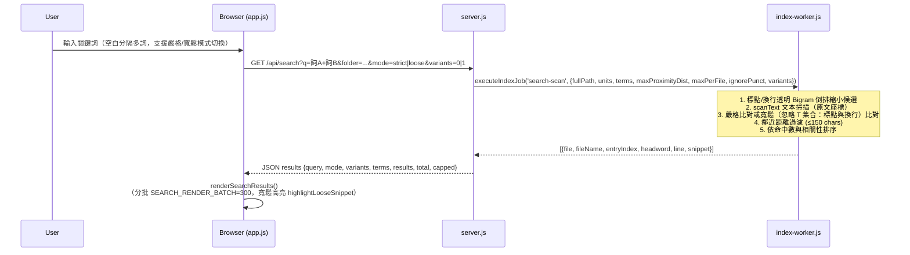

**Bigram 索引架構：**
- **建立時機**：首次搜尋時 lazy build，之後快取（記憶體 + `.bin` 二進位磁碟快取）
- **標點/換行透明性**：CJK 字元間遇到標點符號或行終止符（`\p{P}`、LF `\n`、CR `\r`、NEL `\u0085`、`\u2028`、`\u2029`）等透明字元 T 時不中斷 Bigram 產生（如「菩薩，行深」或跨行「菩薩\n行深」均產生「薩行」）；空白（半形、Tab、全形空格、NBSP）為詞分隔符號不屬於 T（「菩薩 行深」不產生「薩行」）。
- **索引超集不變式 (Index Superset Invariant)**：索引抽取透明集必須 ⊇ 掃描透明集。目前磁碟 `.bin` 以「標點+空白+換行」建置，比掃描的「標點+換行」更寬，故仍為合法超集，無需 bump magic 或重建現有 `.bin`。日後若要放寬掃描透明集（例如重新納入空白），才需 bump magic 並觸發重建。
- **辭典索引**：獨立於主庫索引，避免辭典大小影響主庫搜尋速度
- **索引格式與串流寫入**：`bigramMap: Map<string, number|Uint16Array|Uint32Array>` 記錄 unitId 清單；建置時採 in-place 就地壓縮（單元素收納為 number primitive、多元素原地轉換為 TypedArray，避免雙 Map 同時存活），並以分塊串流（`ChunkedBinaryWriter`）寫入二進位磁碟快取（Magic: 0x42475835 / 0x42475836），不再配置單一巨大 Buffer，使建置過程可平穩完成。
- **部署記憶體需求與 NODE_MAX_OLD_SPACE_MB 調校**：
  - 磁碟快取約 650MB（4.55M unique bigrams），建置峰值記憶體需 ≥ 索引大小之 2 倍。
  - 建議容器或主機記憶體至少 **4GB**（推薦 **8GB**）。
  - 透過 Dockerfile 預設 `NODE_OPTIONS="--max-old-space-size=6144"` 與 `docker-compose.yml` 的 `NODE_MAX_OLD_SPACE_MB` 可自訂 V8 old-space 上限（請勿使用嚴苛的容器 mem_limit 以免未達 GC 門檻即遭 OOM Killer 終止）。

> [!IMPORTANT]
> 本節描述的是**經論主庫全文搜尋（vault search，`/api/search`）**的資料流：單次請求即回傳該次命中的完整（上限內）結果集，沒有分頁游標。**辭典全文搜尋（`/api/dict-search`）走的是另一條路徑**，自 v3.7.6 起改採游標分頁模型，詳見 §5.1。

### 5.1 辭典全文搜尋：游標分頁模型

辭典全文搜尋（`/api/dict-search`）與主庫搜尋在資料流上完全獨立，且**自 v3.7.6 起改為游標分頁（cursor pagination）**，不再是「每檔取前 N 筆並丟棄其餘」的硬性截斷。

**舊行為與問題**：先前 `index-worker.js` 的 `search-scan` 以 `maxPerFile = DICT_SEARCH_MAX_PER_FILE = 1500` 作為**每檔硬性上限**，超出即直接丟棄。對常見詞而言幾乎整個檔案都無法觸及——實測查詢 `一切` 於 `dicts/法相辭典.md` 僅能觸及第 17,172 行（全檔 156,712 行，約 11%）。之所以不選擇直接調高上限，是因為真正的成本在瀏覽器端渲染：5,257 筆結果約產生 26,141 個 DOM 節點與約 1,593 KB HTML，因此改以分頁將每頁結果量固定住，而非放大單次回傳量。

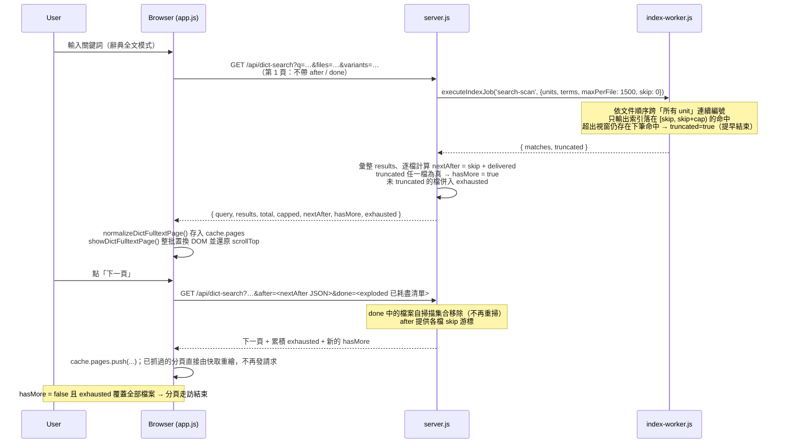

**請求契約（皆為可選參數）**：

| 參數 | 方向 | 格式 | 說明 |
|------|------|------|------|
| `after` | 請求 | URL-encoded JSON 物件 | 以 `dict:` relPath 為鍵，值為「該檔已交付的命中數」。缺少／空字串／非法 JSON／非物件／陣列／非有限數／負數，一律視為 `{}`（即第 1 頁）。鍵空間與回應中 `results[].file` 完全一致，故客戶端可直接把 `nextAfter` 原樣回傳 |
| `done` | 請求 | 逗號分隔的 `dict:` relPath | 客戶端跨頁累積的「已窮盡」檔案清單；這些檔案**完全自掃描集合移除**，避免已窮盡檔案被逐頁重掃。僅接受屬於本次查詢檔案集合的路徑，其餘忽略 |
| `nextAfter` | 回應 | JSON 物件 | **本頁所有被掃描檔案**（無論 truncated 或 exhausted）的最新累積游標，值為 `skip + delivered` |
| `hasMore` | 回應 | boolean | 只要仍有任一檔案存在更多命中即為 `true` |
| `exhausted` | 回應 | `dict:` relPath 陣列 | **累積**清單：本頁新窮盡的檔案，加上請求已透過 `done` 回報者（取聯集） |
| `total` | 回應 | number | 維持原義：**本頁**筆數（非全庫總數） |
| `capped` | 回應 | boolean | 維持原義：本頁是否至少有一個檔案被截斷 |

**回應欄位**：保留 `{query, results, total, capped}` 且語意不變，另新增上述 `nextAfter`、`hasMore`、`exhausted` 三欄。**向後相容**：未帶 `after` / `done` 的請求，回應內容與舊版完全相同，僅多出這三個新欄位。

**驗證期間發現並修正的關鍵缺陷**：`nextAfter` 最初只列出 truncated 的檔案，導致已窮盡檔案沒有游標；下一頁該檔的 `skip` 因此回到 0 而從頭重掃，整個多檔走訪永不終止（實測 30+ 頁、85,728 筆重複結果）。修正後每個被掃描檔案都會輸出游標，且 `done` 機制確保已窮盡檔案不再重掃。

**端到端驗證**：查詢 `法`（涵蓋全部 4 部辭典）的分頁走訪於第 46 頁終止（`hasMore=false`），游標單調不減，交付結果的多重集合與整檔參考掃描**完全相等**——116,634 筆命中，0 筆重複交付、0 筆遺漏。各檔總數與 ground truth 完全一致：佛光辭典 68,868／南山律學辭典 12,173／法相辭典 26,231／淨土藏彙粹 9,362。

**前端（`app.js`）**：`state.dictFulltextCache = { query, files, pageIndex, pages:[{after,results,total,capped,hasMore,nextAfter,scrollTop,done,exhausted}] }`。相關 Helper：`fetchDictFulltextPage`（~L5078）、`normalizeDictFulltextPage`（~L5104）、`showDictFulltextPage`（~L5161）、`dictFulltextNextPage`（~L5183）、`dictFulltextPrevPage`（~L5229）、`renderDictFulltextPager`（~L5248）。渲染一律**整批置換**結果列表（絕不追加），因此 DOM 節點數在任何頁深都維持有界（實測第 1～4 頁為 26.5k → 25.8k 節點）。切頁前會先保存當前頁 `scrollTop`、切回後還原；已抓取過的分頁直接由快取重繪，**不再發出請求**。`下一頁` 以 `hasMore` 為閘、`上一頁` 以 `pageIndex > 0` 為閘；單頁即可容納全部結果時完全不顯示分頁器。頁面快取與 `done` 於 5 處一起重置：空查詢（`runDictSearch` ~L4898）、查詢詞變更（~L4914）、模式切換（~L7087）、單檔核取方塊變更（~L7109）、全選切換（~L7121）。樣式由 `style.css` 的 `.dict-pager`、`.dict-pager-btn`、`.dict-pager-info`（約 L6088）提供，採 flex + `flex-wrap: wrap`，避免可拖曳寬度的側邊欄溢出；所有色彩皆沿用既有 CSS 變數。

### 5.2 已知限制：辭典詞條邊界造成多詞鄰近查詢漏失

> [!WARNING]
> **此限制於 v3.7.6 尚未修正**，僅在此記錄以供後續讀者辨識，避免重複追查。

辭典索引會把大型檔案切分為「以詞條為單位」的多個 unit，因此一個跨越兩個 unit 的鄰近詞叢集，在任一個 unit 內都無法成立，於是多詞鄰近查詢會漏失這類命中。以真實 unit 邊界實測（位元組覆蓋率 100.00%）：`一切 法` 整檔掃描 6,149 筆 vs 逐 unit 掃描 5,212 筆（漏失 937 筆）；`眾生 佛` 為 220 vs 200。關鍵在於 **bigram 前綴過濾本身毫無損失**（逐 unit 候選損失 = 0），全部損失都來自 unitization。單詞查詢不受影響（差異為 0）。線上確認：`q=眾生 佛` 回傳 213 筆，而整檔掃描能找到的某一行確實不在回應中。分頁只影響交付切分、不影響路徑選擇，因此**不會加重**此限制。

### 5.3 字組比對：簡繁變體互相命中（v3.11.0）

索引與經文以繁體為主，但也有簡體來源的檔案（如 `12-智師/未有名師`）；簡體顯示又是用 OpenCC `tw → cn` 逐字轉換畫面。v3.10.x 以前把查詢以 `s2t.js` 轉成「一個」繁體字再比對，畫面與查詢用的是兩張不同的表：`后` 只找 `後`（漏掉皇后）、`发` 只找 `發`（漏掉頭髮）、`头发` 變成 `頭發`、`无为` 只變成 `无為`（找不到 `無為`）、簡體來源檔案完全找不到。v3.11.0 移除 `s2t.js`，改為**字組**比對。

**字組（variant class）**

- 定義：凡是 OpenCC `tw → cn`（與簡體顯示同一個 converter）會轉成同一個簡體字的字，連同該簡體字本身，為同一組：`后 = {后, 後}`、`发 = {发, 發, 髮}`、`着 = {着, 著}`、`为 = {为, 為, 爲}`。只留兩字以上的組；最大組 6 字。
- 產生：`tools/build-search-variants.js` 對 U+3400–U+4DBF、U+4E00–U+9FFF 逐字轉換，以 union-find 取等價類，寫入 `i18n/search-variants.js` 的 `@generated` 區塊；`--check` 只比對。`tests/test-search-variants.test.js` 鎖定產生結果與 vendored OpenCC 同步——**升級 OpenCC 後務必重跑產生器**。
- `EXTRA_VARIANTS`：舊 `s2t.js` 有、但 OpenCC 不會輸出的 17 組簡繁對應（如 `缐→線`、`迳→逕`、`縆→緪`），一併併入。另有 28 組舊對應的繁體字落在 Ext-B 以後的 astral 區（如 `㓆→𠗣`），因索引的 bigram 抽取把 astral 字當斷詞，刻意不收。
- 所有成員都在 BMP，因此 `fold()`（換成代表字）不改變字串長度，位置可直接對應原文。
- 同一模組由 Node（`server.js`、`lib/text.js`、`index-worker.js`）`require`，瀏覽器以 `window.mdSearchVariants` 取用。

**伺服器（`/api/search`、`/api/search-file`、`/api/dict-search`）**

- `isVariantSearch(query)`：`variants=1|0` 優先；未帶時沿用舊參數 `s2t`；兩者皆未帶時預設開啟（與舊預設相同）。前端在簡體顯示或開啟 `autoS2T` 時送 `variants=1`，否則 `variants=0`——**繁體顯示且未開啟設定時為字面比對，結果與 v3.10.x 完全相同**。
- 查詢字串不再改寫，回應的 `query` 是使用者原文，並多一個 `variants` 欄位。
- Bigram 縮小範圍（`indexCandidates()` / `bigramPosting()`）：每個查詢 bigram 展開成「字組 × 字組」的所有組合，取 posting 聯集，再像以前一樣跨 bigram、跨詞交集。單一 bigram 的組合數超過 `DEFAULT_BIGRAM_CAP`（64）時，該 bigram 不參與縮小範圍（其他 bigram 仍會縮小；全部超過時退回全掃描）。
- 掃描（`lib/text.js` `scanText(..., variants)` → `findTermPositions()`）：字組模式以 `[字組]` 字元類組成的 RegExp 比對（寬鬆模式字間允許透明字元），嚴格／寬鬆、單詞／多詞鄰近共用同一套座標邏輯；行號、摘要皆取自原文。
- `searchCache` 鍵為 `mode::variants::folder::q`，切換字組模式不會拿到對方的快取。檔名搜尋兩邊都 `fold()` 後比對。

**前端（`app.js`）**

- 搜尋框、辭典框、頁內搜尋框都不再改寫為繁體；劃詞搜尋送出還原後的繁體原文。
- 搜尋結果摘要與閱讀區高亮用 `termRegexSource()`（字組 RegExp）與 `sameSearchChar()`；寬鬆摘要 `highlightLooseSnippet(..., variants)`。
- 辭典詞頭查詢：前綴查詢在 `fold()` 後的詞頭陣列（`dictFoldedIndex()`，首次使用時建立）上二分搜尋；模糊查詢的 bigram 同樣展開字組組合取聯集。

**實測（本機語料 7,622 檔，v3.10.9 → v3.11.0）**

| 查詢（簡體顯示） | 範圍 | v3.10.9 | v3.11.0 |
| :--- | :--- | ---: | ---: |
| 无为 | 全庫 | 164 筆／32 檔 | 1500+ 筆／110 檔 |
| 头发 | 全庫 | 75 筆／54 檔 | 1500+ 筆／608 檔 |
| 后来 | 全庫 | 123 筆／36 檔 | 1500+ 筆／479 檔 |
| 头发 | `12-智師/未有名師`（含簡體來源） | 0 | 86 筆／27 檔 |
| 无为 | `12-智師/未有名師` | 0 | 1500+ 筆／29 檔 |
| 头发（辭典全文） | 全部辭典 | 0 | 41 |

繁體顯示（`variants=0`）未達上限的查詢，結果集與 v3.10.9 逐筆相同；延遲持平（單次 ~10–350 ms，視命中數）。

---

## 6. 公告彈窗顯示邏輯

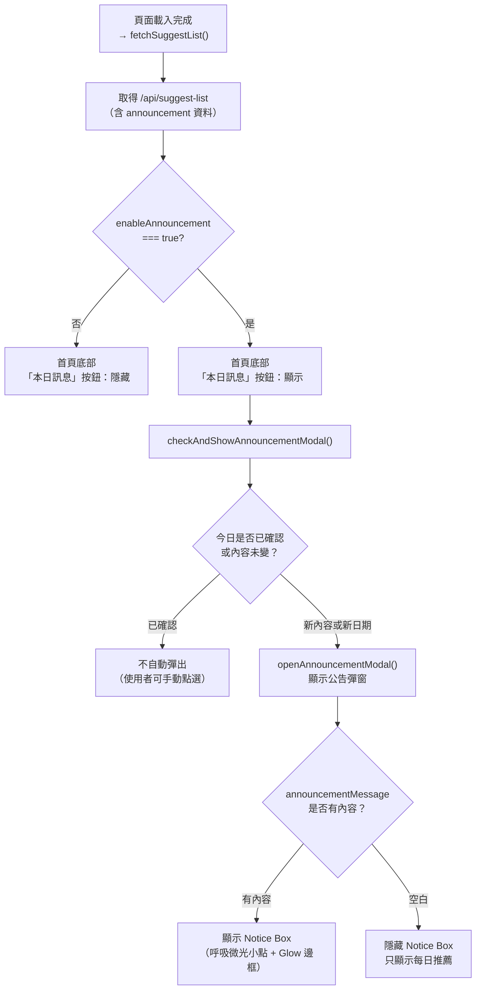

**確認機制（localStorage）：**
- Key: `mdWebview-announcement-modal-ack`
- Value: `{dateKey: 'YYYY-MM-DD', updatedAt: timestamp, itemsSig: hash}`
- 當日期、公告更新時間或推薦清單有任何變化時，強制重新顯示

---

## 7. 使用者偏好與排版控制

為提供無干擾、客製化且安全的閱讀體驗，`app.js` 提供「使用者偏好設定」彈窗（包含「外觀主題」與「視覺排版」兩大分頁，以及整合之「備份與還原」功能）：

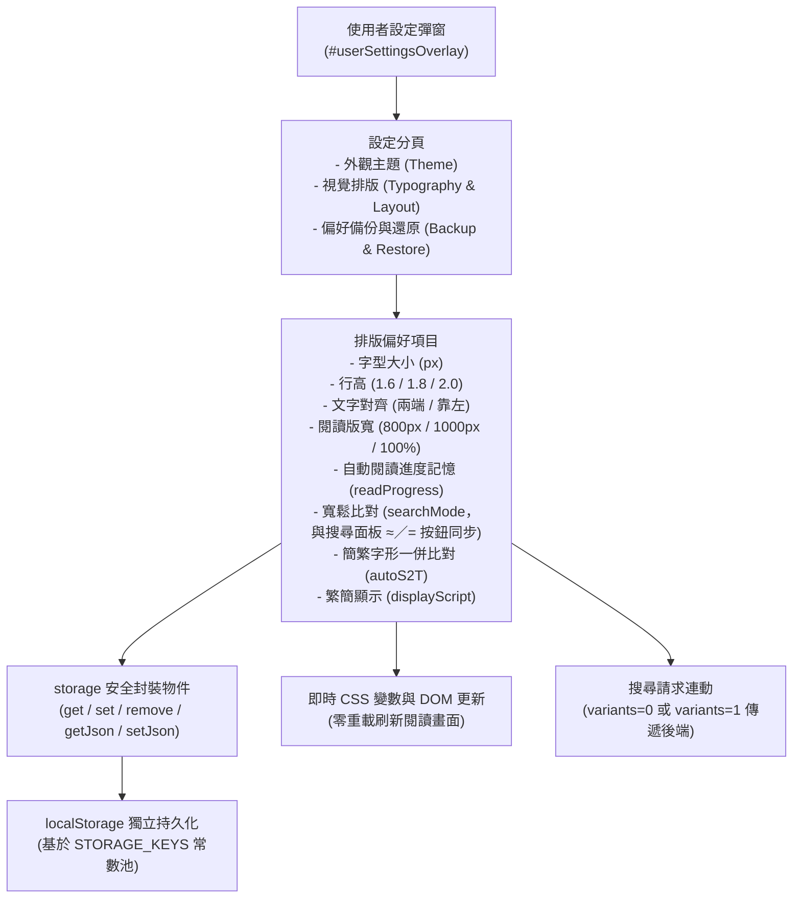

### 7.1 集中式常數池與安全儲存封裝

為消除散落硬編碼（Magic Strings）並防止無痕瀏覽模式、Storage Quota 爆滿或損毀 JSON 導致程式崩潰，前端全面採用集中化儲存機制：

#### 1. STORAGE_KEYS 常數池
| 鍵值常數 | 實際 localStorage 鍵值 | 說明 |
|---------|------------------------|------|
| `THEME` | `mdWebview-user-theme` | 外觀主題 ID（obsidian-dark, obsidian-light 等） |
| `FONT_SIZE` | `mdWebview-user-fontsize` | 使用者設定字體大小（數值 px） |
| `TEXT_ALIGN` | `mdWebview-user-textalign` | 文字對齊（`justify` 或 `left`） |
| `LINE_HEIGHT` | `mdWebview-user-lineheight` | 行高倍率（`1.6`, `1.8`, `2.0`） |
| `MAX_WIDTH` | `mdWebview-user-maxwidth` | 閱讀容器最大寬度（`800px`, `1000px`, `100%`） |
| `AUTO_S2T` | `mdWebview-auto-s2t` | 簡繁字形一併比對開關（`'true'` 或 `'false'`；鍵名沿用舊稱，備份檔向下相容） |
| `DISPLAY_SCRIPT` | `mdWebview-display-script` | 繁簡顯示（`'hant'` 或 `'hans'`；`i18n/boot.js` 也直接讀取此鍵） |
| `READ_PROGRESS_ENABLED` | `mdWebview-user-readprogress` | 是否啟用自動記錄/恢復閱讀進度 |
| `LAST_READ_PROGRESS` | `mdWebview-last-read-progress` | 最近閱讀經文路徑與行號錨點 |
| `RECENT_FILES` | `mdWebview-user-recentfiles` | 最近開啟經文清單（上限 20 筆 JSON） |
| `BOOKMARKS` | `mdWebview-user-bookmarks` | 書籤清單（JSON 陣列 `{path, title, line, ts}`） |
| `ADMIN_TOKEN` | `mdWebview-admin-token` | 後台管理員 Session Bearer Token |
| `ADMIN_TZ` | `mdWebview-admin-tz` | 管理員後台報表指定顯示時區 |
| `DICT_FILE_ORDER` | `mdWebview-dict-file-order` | 辭典顯示順序偏好清單 |
| `DICT_FILE_SELECT` | `mdWebview-dict-selected` | 當前選中辭典索引標籤 |
| `FORCE_FULL` | `mdWebview-force-full` | 虛擬化超大經文強制全量展開旗標 |
| `SEARCH_MODE` | `mdWebview-search-mode` | 全文搜尋模式偏好（`'loose'` 或 `'strict'`） |
| `ANNOUNCEMENT_ACK` | `mdWebview-announcement-modal-ack` | 今日公告已確認紀錄簽章 |
| `INSTALL_DISMISSED` | `mdWebview-install-dismissed` | 婉拒安裝引導的時間戳（3 天內不再提示，見 §17） |
| `INSTALL_INSTALLED` | `mdWebview-install-done` | 已安裝至桌面的旗標，一旦寫入即永久停用所有安裝提示 |

#### 2. storage 防例外包裝工具
- `storage.get(key, fallback)`：內建 try-catch，無拋錯讀取字串。
- `storage.set(key, val)`：寫入安全包裝，捕獲 `QuotaExceededError` 並回傳 boolean。
- `storage.remove(key)`：安全移除項目。
- `storage.getJson(key, fallback)`：解析 JSON，語法錯誤或非預期格式時自動降級回傳 fallback。
- `storage.setJson(key, val)`：自動序列化為 JSON 字串並持久化。

### 7.2 偏好備份與還原機制

- **備份匯出**：於設定彈窗點擊「匯出設定」，將使用者閱讀偏好（含 `searchMode` 全文搜尋模式）、最近閱讀歷史、書籤與外觀打包為標準 JSON 下載（`mdwebview-preferences-YYYY-MM-DD.json`）。
- **資安防護**：匯出程序**嚴格剔除** `STORAGE_KEYS.ADMIN_TOKEN` 與敏感授權資料，確保使用者備份檔案不慎外流時無任何資安風險。
- **還原驗證與向下相容**：支援拖曳或上傳 JSON 檔案，進行結構合法性檢查後原子化覆蓋偏好並即時刷新介面；`searchMode` 經值驗證（只接受 `'loose'` 或 `'strict'`）後還原，若舊備份檔無此欄位則維持現狀，具備完全向下相容性。
- **UI 整合淨化**：移除舊版位於 UI 底部左下角的重複「下載備份」按鈕，統一集中由「使用者設定」彈窗掌管，維持首頁與閱讀介面的乾淨簡約。

### 7.3 簡繁字形一併比對依瀏覽器語言自動啟用（v3.10.3）

站台內文一律為繁體，簡體中文使用者初次造訪時會有閱讀落差，因此對他們預設開啟 `autoS2T`（v3.11.0 起代表「搜尋時簡繁字形一併比對」，見 §5.3；v3.10.x 以前是把查詢簡轉繁）。這項行為刻意寫得保守，避免變成「自作主張」：

**啟動順序是硬性要求**

`maybeAutoEnableS2TFromLocale()` 必須在 `const userAutoS2T = storage.get(...)` **之前**執行（`app.js` 第 205 行）。若順序顛倒，`state.autoS2T` 會先套用舊值（`null → false`），自動啟用的結果永遠進不到 state。此順序由 `tests/test-variant-locale.test.js` 斷言鎖定。

**絕不覆寫使用者已表達的偏好**

```js
if (existing === 'true' || existing === 'false') return false;
```

這是整個設計最重要的一條。若每次載入都依語言重新判斷，使用者手動關閉後下次進站又被打開，等於設定功能失效。因此只有 `AUTO_S2T` 完全不存在時才介入。

**必須寫入 localStorage，不能只改記憶體狀態**

若只改 `state`，重新整理即失效、換分頁不同步、偏好備份匯出不一致，也無法阻止每次載入重複自動啟用。寫入 localStorage 同時解決這四個問題。

**語言判定規則**（`isSimplifiedChineseLocale()`）

| 標籤 | 判定 | 理由 |
| :--- | :---: | :--- |
| `zh-CN`／`zh_CN`／`zh-CN.UTF-8` | ✅ | 地區碼；分隔符先正規化為 `-` |
| `zh-Hans`／`zh-Hans-CN` | ✅ | 語法標記，Chrome 部分平台採用而非地區碼 |
| `zh-SG` | ✅ | 新加坡官方使用簡體 |
| `zh-TW`／`zh-HK`／`zh-Hant` | ❌ | 明確為繁體 |
| `zh`（裸標籤） | ❌ | 無法區分繁簡，寧可維持站台原本的繁體預設 |

判定僅取 `navigator.language`（主要語言），不讀 `navigator.languages`。一個主要語言為英文、僅將 `zh-CN` 排在次要順位者，預期介面語境仍是英文，不應被套用轉換。

`navigator` 不可用或 localStorage 拋錯時，函式一律回傳 `false` 且不拋出例外，確保啟動流程不中斷。

**端對端驗證**（以 CDP `Page.addScriptToEvaluateOnNewDocument` 於頁面載入前覆寫 `navigator.language`）：

| 語言 | 既有設定 | 預期 | 結果 |
| :--- | :--- | :--- | :---: |
| `zh-CN` | 無 | 自動設為 `true`，開關勾選 | ✅ |
| `zh-Hans` | 無 | 自動設為 `true`，開關勾選 | ✅ |
| `zh-TW` | 無 | 保持未設定、開關未勾 | ✅ |
| `en-US` | 無 | 保持未設定、開關未勾 | ✅ |
| `zh-CN` | `'false'` | 尊重既有值，不覆寫 | ✅ |
| `zh-TW` | `'true'` | 保持 `'true'` | ✅ |

### 7.4 繁／簡顯示切換（v3.10.7）

全站預設以繁體顯示；右上角整合選單（`#userMenuPanel`）的「繁簡顯示」可切換整個網站（介面與經文）為簡體，點擊立即切換並寫入 `DISPLAY_SCRIPT`；偏好設定「繁簡顯示」也有同一組選項。

**首次造訪自動切換**

`maybeAutoSelectDisplayScriptFromLocale()` 沿用 §7.3 的三條原則：在讀取 `userDisplayScript` 之前執行、絕不覆寫已存的 `'hant'`／`'hans'`、結果寫入 localStorage。只有「這一次是自動切換」時才在右上角選單按鈕下方顯示提示（簡體撰寫，說明依瀏覽器語言切換、可從右上角選單切回），15 秒後或按「知道了」關閉；之後重新整理不再出現。

**轉換方式：瀏覽器端即時轉換，原文不動**

經文與介面原文都是繁體，伺服器、ETag、SSR 爬蟲頁一律不變。簡體顯示由 `i18n/display-script.js` 在瀏覽器端轉換畫面上的文字節點：

| 區域 | OpenCC 轉換 | 修正表 | 理由 |
| :--- | :--- | :--- | :--- |
| 內文區：`#markdownBody`、`#fileTree`、`#searchResults`、`#tocList`、`#dictResults`、`.file-path`、最近閱讀與書籤… | `tw → cn` 逐字 | `content` | 不做詞彙替換，避免經文用詞被改寫（「軟體」不會變「软件」） |
| 介面區：其餘所有元素 | `twp → cn` 含詞彙 | `ui` | 台灣用語轉大陸用語（檔案→文件、搜尋→搜索、設定→设置） |

- **不轉換**：`script`、`style`、`textarea`（內容）、`code`、`pre`、`kbd`、`samp`、`svg`、`.katex`、`.mermaid`、`[data-no-t2s]`、可編輯區。屬性只轉 `title`、`placeholder`、`aria-label`；`href`、`src`、`id`、`data-*` 不動。
- **動態內容**：`MutationObserver` 監看整份文件，虛擬捲動區塊、搜尋結果、Toast 等新節點自動轉換，`app.js` 的渲染程式不需個別處理。
- **保留原文**：每個被轉換的文字節點與屬性都以 `WeakMap` 記住原文。切回繁體時逐字還原，而非以簡轉繁反推（後／后、髮／发、乾／干 無法反推）。搜尋高亮會切開文字節點、新節點沒有原文紀錄；切回時若偵測到這類節點，就重新渲染目前檔案，確保與原文一致。
- **二次轉換防護**：OpenCC 有三個輸出字再轉一次還會改變（麼→么→幺、薴→苧→苎），程式複製已轉換文字成新節點時會被誤轉，故這些字原樣保留；清單由測試全字掃描驗證。
- **修正表** `i18n/content-terms.js`：鍵是 OpenCC 轉換「後」的簡體字串，例如 `['干慧地', '乾慧地']`。檔頭說明新增步驟。

**搜尋銜接**

- 簡體顯示時 `s2tQueryEnabled()` 一律為真，搜尋以**字組比對**（§5.3）：查詢不改寫，輸入框保留使用者輸入；畫面上的簡體字必定與原字同組，所見即可搜。
- 劃詞搜尋與辭典查詢以 `originalTextOfRange()` 取回**繁體原文**（逐字對齊 `range.toString()`）後送出。
- 閱讀區高亮（`termRegexSource`／`sameSearchChar`）、頁內搜尋（`highlightTextNodes`）與辭典詞頭查詢都以字組比對；wikilink 標題索引（`buildHeadingMap`）以原文建立。

**載入與防閃爍**

- OpenCC（`vendor/opencc/t2cn.js`，opencc-js 1.4.2，約 110 KB，MIT／Apache-2.0）只在簡體顯示時才下載；Service Worker 仍預快取，離線時也能切換。
- `i18n/boot.js` 於 `<head>` 同步執行：預判本次為簡體時先設 `data-display-script="hans"` 並預載 OpenCC，CSS 隱藏 body；`app.js` 轉換完成後設 `data-t2s-ready` 才顯示，4 秒保底。
- 簡體顯示改用系統簡體字型（`--cjk-serif`／`--cjk-sans`），避免 Noto Serif TC 以台灣字形畫簡體字。
- `<html lang>` 隨之切換為 `zh-Hans`／`zh-TW`；前端日期格式改用 `activeLocale()`。OpenCC 載入失敗時畫面退回繁體並提示，但不改寫偏好，下次進站再試。

**介面字串表（i18n）**

`i18n/zh-TW.js`、`i18n/zh-CN.js` 只收錄需依語系撰寫不同措辭的字串（切換按鈕、首次提示、設定說明），以 `mdI18n.t(key, params)` 查表、`data-i18n`／`data-i18n-attr` 標記靜態 HTML。其餘介面文字由上表的介面區轉換處理，因此不必把全部 UI 字串搬進字串表。兩份表的鍵、`{參數}` 與 `index.html` 標記的一致性由 `tests/test-i18n.test.js` 檢查。

**備份相容**：`exportUserPreferences` 匯出 `displayScript`；匯入時只接受 `'hant'`／`'hans'`，舊版備份沒有此欄位時保留目前設定。

**端對端驗證**（無頭 Chrome，以 CDP 覆寫 `navigator.language`）：

| 情境 | 預期 | 結果 |
| :--- | :--- | :---: |
| `zh-CN` 首次造訪 | 自動切簡體、寫入 `'hans'`、按鈕顯示「简」、出現提示、介面與經文皆簡體 | ✅ |
| 重新整理 | 維持簡體、不再提示 | ✅ |
| 簡體下頁內搜尋（簡／繁關鍵字）、全庫搜尋（簡體輸入） | 皆可命中，結果以簡體顯示 | ✅ |
| 簡體下劃詞搜尋 | 送出繁體原文「照見五蘊」 | ✅ |
| 辭典結果與詞條 | 以簡體顯示 | ✅ |
| 頁內搜尋高亮後切回繁體 | 經文與直接以繁體開啟者逐字相同 | ✅ |
| `zh-TW` 首次造訪 | 維持繁體、不寫入、不提示、不下載 OpenCC | ✅ |
| 繁體下手動切簡體 | 即時轉換、記住偏好、不跳首次提示 | ✅ |
| 375px 行動版 | 按鈕可見且在畫面內 | ✅ |

---

## 8. 後端模組架構與 API 路由索引

後端採用 **原生 CommonJS 模組解耦架構**，無任何外部第三方 HTTP 框架（如 Express/Fastify）。`server.js` 作為頂層組裝入口，所有重型與專項業務邏輯抽離至 `lib/` 目錄下的原生模組。

### 8.1 lib/ 原生模組職責劃分

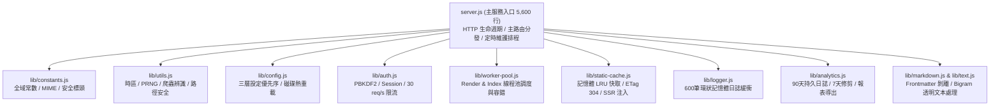

| 模組檔案 | 核心職責 | 主要導出方法與物件 |
|---------|---------|-------------------|
| `lib/constants.js` | 集中定義系統全域常數、MIME 類型、安全性 HTTP 標頭與版本資訊 | `APP_ROOT`, `PORT`, `CONFIG_PATH`, `APP_VERSION`, `MAX_LOG_BUFFER`, `CRAWLER_UA_REGEX`, `LOG_DIR`, `ANALYTICS_STORE_PATH`, `MIME_TYPES`, `SECURITY_HEADERS` |
| `lib/utils.js` | 零依賴通用公用函數：字串跳脫、時區轉換、PRNG、安全解碼與路徑遍歷防護 | `escapeXml`, `formatTimestampInTz`, `mulberry32`, `getCrawlerName`, `isCrawlerRequest`, `isBotEntry`, `extractAnalyticsPath`, `getRootRealpath`, `isRealPathWithinRoot`, `flattenMarkdownFiles`, `getClientIP`, `getBaseUrl`, `safeDecodeURI`, `safeDecodeURIComponent` |
| `lib/config.js` | 系統設定生命週期管理：3 層優先序載入、原子儲存、`fs.watch` 熱重載、Markdown/辭典根路徑解析與記憶化快取 | `config`, `loadConfig`, `saveConfig`, `setupConfigWatcher`, `resetConfigWatcher`, `getMdRoot`, `deriveDictRoot`, `getDictionaryPath`, `invalidateMdRootMemo`, `isRealPathWithinMdRoot` |
| `lib/auth.js` | 管理員權限閘門（讀 `lib/session.js` 的 session 並檢查 role=admin）、時序安全比對、滑動視窗 API 限流（30 req/s）、CSRF 同源驗證 | `loginAttempts`, `MAX_ATTEMPTS`, `LOCK_DURATION`, `MAX_LOGIN_ENTRIES`, `checkApiRateLimit`, `timingSafeCompare`, `hashPassword`（僅舊格式）, `verifySameOrigin`, `getAdminUser`, `isAuthenticated`, `isAuthorizedAdmin`, `requireAdmin`, `readJSONBody` |
| `lib/db.js` | 帳號資料庫（`node:sqlite`，WAL）：結構遷移、所有 SQL、每日備份與還原、過期資料清理 | `open`, `close`, `isAvailable`, `getStatus`, 使用者／第三方綁定／信件 token／邀請碼／session／稽核紀錄／設定的存取函式, `backupNow`, `restoreBackup` |
| `lib/password.js` | scrypt 密碼雜湊（PHC 格式字串）、舊 PBKDF2 相容與登入時自動升級、密碼規則 | `hashPassword`, `verifyPassword`, `needsRehash`, `validatePassword`, `legacyPbkdf2Hash` |
| `lib/session.js` | Cookie session（`__Host-mdw_sid`／`mdw_sid`，HttpOnly、SameSite=Lax）、沒用才過期（一般 30 天、管理員 7 天）、重新驗證時窗 | `startSession`, `getSession`, `getUser`, `endSession`, `hasRecentReauth`, `markReauth`, `isSecureRequest` |
| `lib/accounts.js` | 帳號路由：註冊、登入、驗證信、重設密碼、我的帳號、第三方登入回調、`/privacy` `/terms`、`/api/health`、後台帳號 API；登入限速與防機器人 | `init`, `handle`, `isAccountRoute`, `ADMIN_ROUTES`, `setupFirstAdmin`, `handleLegacyAdminLogin`, `handleLogout` |
| `lib/oauth.js` | Google（OIDC + PKCE）、Facebook、Apple（form_post）登入流程 | `begin`, `complete`, `enabledProviders`, `getStatus` |
| `lib/mailer.js` | 寄信（Resend HTTP API，或 `log` 模式只寫日誌） | `send`, `renderMail`, `getStatus`, `getOutbox` |
| `lib/turnstile.js` | Cloudflare Turnstile 伺服器端驗證 | `verify`, `isConfigured`, `getSiteKey` |
| `lib/worker-pool.js` | 背景 Worker Thread 池生命週期調度：Render Pool 與 Index Pool 管理、Backpressure 佇列上限、逾時熔斷重生、指數退避防 Crash Loop | `workerPool`, `indexWorkerPool`, `initWorkerPool`, `initIndexWorkerPool`, `renderWithWorker`, `executeIndexJob`, `runIndexWorkerPool`, `terminateWorkerPools` |
| `lib/analytics.js` | 訪客統計與行為日誌：90 天持久化存取紀錄、7 天自動修剪排程、動態指標即時聚合、時區校正查詢、CSV/JSON 匯出 | `analyticsStore`（**getter**，見 §13.1）, `getLogFilePath`, `appendToPersistentLog`, `getAnalyticsEventId`, `assignAnalyticsEventSeq`, `updateAnalyticsStoreEntry`, `saveAnalyticsStore`, `queueAnalyticsStoreEntry`, `initializeAnalyticsStore`, `cleanOldLogsJob`, `pruneAnalyticsLogEntry`, `buildAggregateAnalyticsData`, `getAnalyticsData`, `parseAnalyticsRange`, `setInMemoryLogBufferRef` |
| `lib/logger.js` | 記憶體結構化系統日誌：600 筆環狀緩衝（Ring Buffer）、後台 API 輸出、標準控制台日誌封裝、**唯一 URL 解碼點** | `systemLogBuffer`, `pushToLogBuffer`, `Logger` (`info`, `warn`, `error`, `debug`) |
| `lib/static-cache.js` | 靜態資產快取與 SSR 注入：記憶體 LRU 快取（5s TTL）、If-None-Match 304 快速協商、Gzip 壓縮、首頁動態 SSR 注入、**I/O 失敗記錄** | `serveStatic`, `staticCache`, `sendCompressed`, `sendJSON`, `indexHtmlHeaders`, `escapeHtmlString`, `safeJsonForScript`, `getIndexHtml` |
| `lib/markdown.js` | Markdown 與 Frontmatter 文本處理：YAML 標頭剝離、metadata 解析與行號偏移 (lineOffset) 計算 | `stripFrontmatter` |
| `lib/text.js` | 索引與搜尋共用的文本正規化層：CJK 判定、標點/換行透明集合判定、Bigram 抽取、寬鬆模式比對與文本掃描（Index/Render Worker 皆引用，確保索引抽取透明集 ⊇ 掃描透明集） | `isCJKIdeograph`, `isTransparent`, `extractBigramsFromText`, `normalizeLooseTerm`, `SNIPPET_RADIUS`, `localLineAt`, `findLoose`, `matchLooseSequence`, `scanText` |

### 8.2 server.js 段落分區表（Section Map）

`server.js` 約 5,640 行、86 個頂層函式。下表行號為 v3.10.4 實測值，改動後會位移——**請以區段標題或函式名搜尋**。

| 段落 | 起始行 | 行數 | 職責 |
| :--- | ---: | ---: | :--- |
| `§2–§5` | 165 | 237 | Worker Pool、Config、Static Cache、SSR 的**組裝層**（實作已移至 `lib/`） |
| `§6` | 402 | 24 | `handleTree`（`/api/tree`）與 `fs.watch` 快取失效 |
| `§7` | 426 | 241 | SEO：`robots.txt`、`manifest.json`、`sitemap.xml` |
| `§8` | 667 | 263 | `handleCrawlerSsr()` 爬蟲預渲染 |
| `§9` | 930 | 305 | `handleFile`（`/api/file`）、`handleMedia`（`/api/media`） |
| `§10` | 1235 | 239 | 大檔分塊 API：`handleSectionIndex`、`handleRenderChunk` |
| `§14` | 1474 | 48 | 搜尋處理器（掛載點，實作見 §12） |
| `§12` | 1522 | 18 | **僅狀態與常數**：`searchIndex` 物件、快取路徑 |
| `§11` | 1540 | 471 | 章節索引引擎：`getSectionIndex`、二進位磁碟快取、去抖寫入 |
| `§12 (續)` | 2011 | 591 | 全文 Bigram 索引本體：`buildSearchIndexAsync`、載入／儲存 |
| `§13` | 2602 | 1,189 | 辭典索引與 API：`buildDictIndexAsync`、`handleDictHeadwords`、`handleDictSearch` |
| `§15–§17` | 3791 | 186 | Static Cache、Auth、Rate Limiting、Analytics 的**組裝層**（實作已移至 `lib/`） |
| `§18` | 3977 | 212 | 每日單詞與推薦：Mulberry32 決定性 PRNG、`handleSuggestList` |
| `§19` | 4189 | 82 | 硬體工具函式：`getDockerMemoryLimit`、`getDirSizeAsync`、`getCpuUsagePct`、`isDockerContainer` |
| `§19 (續)` | 4271 | 209 | `getSystemHardwareStats` 聚合器、`handleHardwareStats` |
| `§19.5` | 4480 | 358 | 後台維護：重建索引／辭典、改密碼、路徑診斷、重建 sitemap、清快取 |
| `§20` | 4838 | 803 | HTTP Server 建立與主路由分派（40+ 條 `pathname` 比對） |

> **編號非遞增**：實際排列為 §6 → §7 → §8 → §9 → §10 → §14 → §12 → §11 → §13 → §15 → §18 → §19 → §19.5 → §20。
> 原因為 §11／§12／§13 是後來插入的大型引擎（章節索引、全文索引、辭典索引），為避免搬動既有程式碼而就地插入。`§12` 的標記位置只放狀態常數，函式本體在 `§12 (續)`。

### 8.3 server.js API 路由索引表

`server.js` 負責核心請求攔截、路由分派以及搜尋/章節索引之調度：

| 路徑 | Method | Handler / 關聯模組 | 需要 Auth | 說明 |
|------|--------|-------------------|-----------|------|
| `/` | GET | `getIndexHtml()` (`lib/static-cache.js`) | ❌ | SPA 首頁（SSR 動態注入 siteName、主題、設定） |
| `/manifest.json` | GET | `handleManifestJson()` | ❌ | PWA Web App Manifest（動態站名） |
| `/robots.txt` | GET | `handleRobotsTxt()` | ❌ | SEO 搜尋引擎檢索指令 |
| `/sitemap.xml` | GET | `handleSitemapXml()` | ❌ | SEO 站點地圖（20s 沉降防抖 + Stale 快取） |
| `/api/tree` | GET | `handleTree()` | ❌ | 取得經論 Markdown 目錄樹（支援快取與熱失效） |
| `/api/file` | GET | `handleFile()` | ❌ | 取得經論 .md 原文內容 |
| `/api/media` | GET | `handleMedia()` | ❌ | 靜態媒體服務（圖片、PDF、音訊，支援 Range） |
| `/api/render` | GET | `handleRender()` | ❌ | 經文渲染 API（小型檔案完整渲染並提取 Meta） |
| `/api/section-index` | GET | `handleSectionIndex()` | ❌ | 大型經論與辭典章節分塊 Metadata (.bin 磁碟快取) |
| `/api/render-chunk` | GET | `handleRenderChunk()` | ❌ | 大型經論特定分塊動態渲染（Worker 調度） |
| `/api/search` | GET | `handleSearch()` | ❌ | Bigram 全文倒排檢索（支援 variants 字組比對、mode=strict|loose 寬鬆模式與鄰近過濾） |
| `/api/search-file` | GET | `handleSearchFile()` | ❌ | 單一經論檔案內文檢索（虛擬化模式的頁內搜尋） |
| `/api/dict-headwords` | GET | `handleDictHeadwords()` | ❌ | 辭典詞條倒排索引資料（支援 `If-None-Match` 304） |
| `/api/dict-search` | GET | `handleDictSearch()` | ❌ | 佛學辭典多模式搜尋（前綴 / 全文）；全文模式自 v3.7.6 起採**游標分頁**（`after` / `done` 進、`nextAfter` / `hasMore` / `exhausted` 出，每頁每檔 1500 筆） |
| `/api/dict-event` | POST | `handleDictEvent()` | ❌ | 辭典查閱行為日誌 Beacon |
| `/api/dict-files` | GET | `handleDictFiles()` | ❌ | 辭典來源檔案清單 |
| `/api/suggest-list` | GET | `handleSuggestList()` | ❌ | 首頁推薦經論、熱門榜與每日單詞 |
| `/api/admin/setup` | POST | 伺服器首次管理員初始化 | ❌ | 首次部署管理員帳號與 siteUrl 設定 |
| `/api/admin/login` | POST | PBKDF2 驗證 (`lib/auth.js`) | ❌ | 管理員登入（防暴力破解鎖定 15m） |
| `/api/admin/logout` | POST | Session 註銷 (`lib/auth.js`) | ✅ | 登出並使 Token 失效 |
| `/api/admin/status` | GET | 狀態偵測 | ❌ | 檢查系統是否已初始化及管理員認證狀態；已認證時另含 `sectionIndexCache`（章節索引三層快取的 `lruHit`/`mirrorHit`/`build`/`evictions`/`hitRatePct` 統計） |
| `/api/admin/settings` | GET | 讀取設定 (`lib/config.js`) | ✅ | 取得當前伺服器 config.settings |
| `/api/admin/settings` | POST | 儲存設定 (`lib/config.js`) | ✅ | 更新系統設定、目錄路徑與 SEO 參數 |
| `/api/admin/logs` | GET | 系統日誌 (`lib/logger.js`) | ✅ | 讀取 600 筆環狀記憶體日誌 |
| `/api/admin/analytics` | GET | 報表查詢 (`lib/analytics.js`) | ✅ | 依時區聚合讀取訪問量、PV/UV、熱門排行 |
| `/api/admin/analytics/export`| GET | 報表匯出 (`lib/analytics.js`)| ✅ | 匯出結構化 CSV 或 JSON 格式分析資料（**僅接受 `X-Admin-Token` 標頭，不接受 `?token=`**） |
| `/api/admin/hardware` | GET | `handleHardwareStats()` | ✅ | 取得伺服器硬體負載（CPU、RAM、Uptime） |
| `/api/admin/rebuild-index` | POST | `handleRebuildIndex()` | ✅ | 手動觸發非同步重建 Bigram 搜尋索引 |
| `/api/admin/rebuild-dict-index`| POST| `handleRebuildDictIndex()` | ✅ | 手動觸發非同步重建辭典倒排索引 |
| `/api/admin/rebuild-sitemap`| POST | `handleAdminRebuildSitemap()`| ✅ | 強制手動立即重新生成 Sitemap |
| `/api/admin/clear-cache` | POST | `handleAdminClearCache()` | ✅ | 清除記憶體靜態快取與搜尋暫存 |
| `/api/admin/password` | POST | `handleAdminPassword()` | ✅ | 更新管理員登入密碼 |
| `/api/admin/diagnose-path`| POST | `handleAdminDiagnosePath()` | ✅ | 檢測經論與辭典磁碟路徑可讀性 |
| `/api/admin/seo-stats` | GET | SEO 統計資訊 | ✅ | 取得目前 Sitemap、Robots 與經論統計數 |
| `/*` (靜態資源) | GET | `serveStatic()` (`lib/static-cache.js`) | ❌ | 靜態檔案（HTML, CSS, JS, 字型, 圖片） |

> [!NOTE]
> - 所有 `/api/*` 路由均受 Global Rate Limiter 保護（30 req/s per IP，滑動視窗）。
> - 管理員 API 需通過 `verifySameOrigin` CSRF 同源驗證，並攜帶有效 session token（一律以 `X-Admin-Token` 標頭傳遞）。
> - `/api/admin/analytics/export` 不再接受 `?token=` 查詢字串認證，僅認可 `X-Admin-Token` 標頭。

---

## 9. app.js 前端架構與 State 物件說明

前端單頁應用採用無編譯純 JavaScript（ES6+）IIFE 封裝，依職責劃分為 24 個邏輯段落（§0-§23）。

### 9.1 段落索引與通用 Helper

#### 1. 邏輯段落分區表（Section Map）

`app.js` 為單一 IIFE（約 11,300 行、246 個函式），所有函式共用同一閉包。下表行號為 v3.10.4 的實測值，改動後會位移——**請以區塊標題搜尋，勿依賴行號**。

| 段落 | 起始行 | 行數 | 核心模組 | 職責與功能概述 |
| :--- | ---: | ---: | :--- | :--- |
| `§0` | 61 | 454 | Globals & State | 全域集中 `STORAGE_KEYS`、`storage` 安全封裝、LRU 快取、`state` 物件 |
| `§1` | 515 | 204 | Init & Boot Hooks | `loadSettings()`、`initUI()`、URL 參數解析（`parseUrlParams()`） |
| `§16.5` | 719 | 956 | PWA Install Prompt | 首頁安裝卡片、iOS 三步驟教學 Modal、設定常駐入口（見 §17） |
| `§2` | 1675 | 158 | Site Name & Footer | 站台名稱即時更新、頁尾版本與公告控制 |
| `§3` | 1833 | 136 | Suggest List | 首頁推薦經論、熱門榜與每日單詞（PRNG 輪換） |
| `§4` | 1969 | 263 | Announcement Modal | 公告訊息彈窗顯示與今日已讀簽章驗證 |
| `§5` | 2232 | 262 | File Tree | 經論目錄樹建置、過濾、排序與非同步渲染 |
| `§6` | 2494 | 1,748 | Markdown Viewer | 小型經論渲染、標題錨點、雙向註腳跳轉、大檔虛擬化 |
| `§7` | 4242 | 221 | Wikilink Resolver | 內部經文雙鏈快速跳轉與索引比對 |
| `§8` | 4463 | 341 | Table of Contents | 大綱目錄生成、ScrollSpy 滾動追蹤高亮 |
| `§9` | 4804 | 337 | Global Search | Bigram 全文搜尋、分批渲染（300 筆/批）防介面凍結 |
| `§10` | 5141 | 755 | Dictionary Sidebar | 佛學辭典抽屜、前綴與全文檢索、分詞查閱 |
| `§11` | 5896 | 223 | In-Page Search | 頁內即時高亮搜尋與跳轉（Ctrl+F） |
| `§12` | 6119 | 67 | Theme | 主題切換與即時 CSS 變數套用 |
| `§13` | 6186 | 33 | Font Size | 字體大小即時縮放與持久化 |
| `§14` | 6219 | 115 | Text/Layout Preferences | 對齊、行高、閱讀版寬、簡繁字形一併比對開關 |
| `§15` | 6334 | 62 | Recent Files | 最近閱讀經文紀錄（最多 20 筆） |
| `§16` | 6396 | 97 | Toast Notifications | 全域浮動提示通知（`showToast`） |
| `§17` | 6493 | 100 | Bookmarks | 經本書籤收藏管理 |
| `§18` | 6593 | 103 | Read Progress | 閱讀進度二分搜尋測量與自動恢復 |
| `§18.5` | 6696 | 154 | Preferences Backup | 使用者偏好匯出／匯入 JSON |
| `§19` | 6850 | 96 | Sidebar Resize | 側邊欄拖曳調整寬度 |
| `§6.5` | 6946 | 354 | Media Lightbox | 圖片全螢幕放大、拖曳、雙擊與雙指捏合縮放 |
| `§20` | 7300 | 1,327 | Event Listeners | `setupEventListeners()`：全站事件綁定（全檔最大單一函式） |
| `§21` | 8627 | 2,419 | Admin Panel | 後台管理面板（內含 6 個子群，見下） |
| `§22` | 11046 | 246 | Utilities | 通用轉義、時區格式化、通用 Helper |
| `§23` | 11292 | 5 | Boot Entry | DOMContentLoaded 初始化啟動入口 |

> **編號非遞增**：實際排列為 §0 → §1 → §16.5 → §2 … → §19 → §6.5 → §20 → §21。
> §6.5 與 §16.5 是後續功能插入時就地放置，未重排既有程式碼。搜尋時請用標題關鍵字。

#### 1.1 §21 後台面板子群索引

§21 佔 2,419 行、44 個函式，是全檔最大區塊。內部依功能可分為六群：

| 子群 | 內容 | 代表函式 |
| :--- | :--- | :--- |
| §21.1 | 面板開關與髒值追蹤 | `closeAdminModal`、`setAdminDirty`、`setupAdminDirtyTracking` |
| §21.2 | 帳號與設定維護 | `setupChangePassword`、`setupConfigBackupAndRestore`、`setupPathDiagnostics`、`setupHardwareClearCache` |
| §21.3 | 流量趨勢圖繪製 | `computeNiceScale`、`monotonePath`、`renderAnalyticsTrendChart` |
| §21.4 | 硬體監控儀表板 | `formatBytes`、`formatUptime`、`loadHardwareStats`、`renderHardwareDashboard`、`setupHardwareIndexRebuild` |
| §21.5 | 日誌與流量報表 | `openSettingsOverlay`、`filterLogEntries`、`fetchAdminLogs`、`loadAdminAnalytics`、`renderAdminAnalytics` |
| §21.6 | 設定表單與 SEO | `setupAdminTabEvents`、`setupArticlePicker`、`setupSuggestFormEvents`、`loadSeoSettings`、`setupAdminSeoEvents` |

§21.3 是唯一可獨立測試的子群：`computeNiceScale` 與 `monotonePath` 為純函式，不碰網路與 `state`，由 `tests/test-analytics-chart.test.js` 以原始碼抽取方式實際執行驗證。

#### 2. 前端通用 Helper
- `isNarrowScreen()`：整合行動裝置 User-Agent 識別與 `window.innerWidth <= 768` 判斷，全站統一響應式邊界判斷。
- `getTodayDateIso()`：取得 ISO 格式今日日期字串（`YYYY-MM-DD`），用於公告 ack 比對與日誌校驗。
- `log`：統一前端彩色控制台日誌工具（`info`, `warn`, `error`）。

### 9.2 State 物件欄位一覽

`state` 是 `app.js` 的單一全域狀態物件（IIFE 內部，非 window 全域）：

| 欄位 | 型別 | 說明 |
|------|------|------|
| `currentFile` | `string|null` | 當前開啟的檔案路徑（`null` = 首頁歡迎畫面） |
| `currentTheme` | `string` | 主題 ID：`obsidian-dark`|`obsidian-light`|`solarized`|`zen`|`gruvbox` |
| `defaultFontSize` | `number` | 伺服器設定的預設字體大小（px），作為重置基準 |
| `fontSize` | `number` | 當前閱讀字體大小（px），使用者可調整 |
| `textAlign` | `string` | 文字對齊：`justify`|`left` |
| `lineHeight` | `string` | 行高倍數字串：`'1.6'`|`'1.8'`|`'2.0'` |
| `maxWidth` | `string` | 閱讀區最大寬度 CSS 值，行動版預設 `95%`，桌面版 `800px` |
| `autoReadProgress` | `boolean` | 是否自動儲存/恢復閱讀進度 |
| `autoS2T` | `boolean` | 搜尋時是否簡繁字形一併比對（字組比對，§5.3；簡體顯示時不論此值一律開啟）。全站預設 `false`；若使用者從未設定過，且瀏覽器主要語言為簡體中文，首次造訪時自動設為 `true` 並寫入 localStorage（見 §7.3） |
| `displayScript` | `string` | 繁簡顯示，`'hant'`（預設）或 `'hans'`。規則同 `autoS2T`：從未設定且瀏覽器為簡體中文時，首次造訪自動設為 `'hans'` 並顯示一次提示（見 §7.4） |
| `isMobile` | `boolean` | 是否為行動裝置（UA 或視窗寬度 ≤ 768px） |
| `siteName` | `string` | 站台名稱，來自 `config.settings.siteName`，預設 `'mdWebview'` |
| `treeData` | `Array|null` | 檔案樹 JSON（`null` = 尚未從 `/api/tree` 載入） |
| `fileSort` | `string` | 檔案排序：`name-asc`|`name-desc`|`modified-asc`|`modified-desc` |
| `fileSizes` | `Map` | `filePath → bytes`，用於判斷是否需要虛擬化渲染 |
| `dictFileSizePaths` | `Set` | 目前辭典清單中已知的 `dict:` 路徑集合；每次詞頭刷新時用以回收已移除辭典在 `fileSizes` 的殘留項 |
| `recentFiles` | `string[]` | 最近開啟的檔案路徑（最多 20 筆，持久化於 localStorage） |
| `bookmarks` | `Object[]` | 書籤列表 `{path, title, line, ts}`，持久化於 localStorage |
| `sidebarTab` | `string` | 側邊欄分頁：`'files'`|`'search'`|`'toc'` |
| `sidebarCollapsed` | `boolean` | 側邊欄是否已收合 |
| `pageSearchMatches` | `Object[]` | 頁內搜尋（Ctrl+F）的命中節點列表 |
| `pageSearchIndex` | `number` | 當前高亮命中索引（`-1` = 無） |
| `pageSearchQuery` | `string|null` | 最後一次頁內搜尋關鍵詞 |
| `searchSort` | `string` | 搜尋結果排序：`relevance`|`file-asc`|`file-desc`|`count-desc` |
| `searchMode` | `'loose'|'strict'` | 當前全文搜尋模式（優先讀取 localStorage 偏好，fallback 至 `appConfig.defaultSearchMode`，預設 `'loose'`） |
| `lastSearchData` | `Object|null` | 最後搜尋回傳資料（換頁排序時不重新請求） |
| `searchRenderLimit` | `number` | 已渲染的搜尋結果筆數（分批渲染計數） |
| `scrollSpyObserver` | `IntersectionObserver|null` | TOC 高亮用的 IntersectionObserver |
| `scrollSpyHandler` | `Function|null` | scroll 事件 handler 參考（用於移除） |
| `scrollSpyResizeHandler` | `Function|null` | resize 事件 handler 參考 |
| `scrollSpyRaf` | `number|null` | requestAnimationFrame ID |
| `refreshScrollSpy` | `Function|null` | 重新初始化 ScrollSpy 的函數參考 |
| `virtual` | `Object|null` | 大型檔案虛擬化狀態（`null` = 非虛擬化模式）。結構：`{filePath, abortController, entries, groups, totalLines, totalEntries, chunkRanges, chunks, inflight, errorChunks, chunkHeights, avgPxPerLine, spacerTop, spacerBottom, _tocItems, _tocWindow, ...}` |
| `_openToken` | `number` | 開檔世代計數器；`goHome()` 與每次 `openFile()` 皆自增，用以判定非同步回應是否已過期 |
| `_openFileAbort` | `AbortController|null` | 當前開檔請求的取消控制器；切換檔案或返回首頁時呼叫 `abort()` 並清空 |
| `sectionIndexCache` | `Map` | `filePath → {etag, si}` 的 section index 快取 |
| `dictionaryEnabled` | `boolean` | 後台是否啟用辭典功能 |
| `dictHeadwords` | `Object|null` | 辭典詞條索引（由 `/api/dict/headwords` 載入） |
| `dictIndex` | `Object|null` | 當前辭典條目詳情 |
| `dictSelected` | `string|null` | 當前查詢的辭典詞條 |
| `dictFileOrder` | `string[]|null` | 辭典檔案顯示順序 |
| `dictSidebarOpen` | `boolean` | 辭典側邊欄是否開啟 |
| `dictMode` | `string` | 查詢模式：`'prefix'`（前綴）|`'fulltext'`（全文） |
| `dictAbortController` | `AbortController|null` | 取消進行中辭典請求 |
| `dictFulltextCache` | `Object|null` | 辭典全文搜尋的**分頁快取**。結構：`{query, files, pageIndex, pages:[{after, results, total, capped, hasMore, nextAfter, scrollTop, done, exhausted}]}`。`after` 為產生該頁的游標、`nextAfter` 為下一頁游標、`done` 為該頁帶入的已窮盡清單。已抓取的分頁直接重繪不重發請求；於 5 處與 `dictFulltextScrollTop` 一起重置：空查詢（`runDictSearch` ~L4898）、查詢詞變更（~L4914）、模式切換（~L7087）、單檔核取方塊變更（~L7109）、全選切換（~L7121）（`null` = 尚無分頁走訪） |
| `dictFulltextScrollTop` | `number` | 辭典全文搜尋結果的滾動位置；切頁前保存當前頁、還原時寫回對應 `pages[i].scrollTop`，並隨頁面快取於上述 5 處一併歸零 |
| `dictSidebarWidth` | `number|null` | 辭典側邊欄寬度（px），使用者可拖拉調整 |
| `dictHeadwordsETag` | `string|null` | 辭典 headwords 的 ETag（用於 304 Not Modified） |
| `dictPollTimer` | `number|null` | 辭典輪詢 timer ID（檢查辭典更新） |
| `adminToken` | `string|null` | 管理員 session token（持久化於 localStorage） |
| `_announcementModalContext` | `Object|null` | 公告彈窗最後開啟時的資料快照（用於判斷是否重複顯示） |
| `_cachedSuggestItems` | `Object[]|null` | 最後一次 `/api/suggest-list` 的推薦項目快取 |

### 9.3 URL 路由參數與全庫搜尋深層連結（v3.9.1）

`parseUrlParams(search, hash)`（~L650）是**純函式**，把網址列參數轉為路由資訊，`getFileFromURL()` 僅是它的 `window` 包裝。抽成純函式是為了可測試：`tests/test-search-deeplink.test.js` 以 `vm` 直接求值驗證，不需真實瀏覽器。

| 參數 | 語意 |
| :--- | :--- |
| `?file=PATH&line=N` | 開啟經文並跳至指定行 |
| `?file=PATH&q=KW` | 開啟經文並在文內標示 `KW`（傳入 `openFile()` 的 `highlightQuery`） |
| `?search=KW` | 開啟側邊欄搜尋分頁、帶入 `KW` 並執行全庫搜尋 |
| `?home=1` / `?frontpage=1` / `?page=home` | 回首頁 |
| `#file=…` / `#home` | 舊版雜湊格式（保留回溯相容） |

**優先序**：`search` 一律最優先，其次 `home`，再其次 `file`。將 `search` 置頂是安全的——它於 v3.9.1 才新增，既有書籤不可能帶有它。

**`activateSearchPanel(query)`**（~L4422）是「展開側欄 → 切至搜尋分頁 → 填入 → 執行 → 同步網址」的唯一實作。三個入口共用：`?search=`、右鍵選單的「全文庫搜尋」、`popstate`（上一頁／下一頁）。歷史上只有右鍵那條路徑手寫整段流程，重複實作必然走鐘，故集中於此。

**`?q=` 曾被靜默丟棄（v3.9.1 修正）**：`getFileFromURL()` 一直有解析 `q`／`query`，但開機流程只傳 `urlInfo.file` 與 `urlInfo.line` 給 `openFile()`，`highlightQuery` 參數雖存在卻永遠沒有來源。現在已接上。

### 9.4 WebSite + SearchAction 結構化資料（v3.9.1）

`seoEnableSearchBox` 曾是**空轉開關**：值會寫入 `config.json` 且開關畫在設定頁，但全庫沒有任何程式碼讀取它，因此設定頁「提供搜尋結果站內檢索框」的說明從未成立。現在由 `lib/static-cache.js` 的 `getIndexHtml()`（~L190）依 toggle 產出帶 CSP nonce 的 JSON-LD：

```json
{"@context":"https://schema.org","@type":"WebSite","url":"<base>/",
 "potentialAction":{"@type":"SearchAction",
   "target":{"@type":"EntryPoint","urlTemplate":"<base>/?search={search_term_string}"},
   "query-input":"required name=search_term_string"}}
```

三個邊界條件：

1. **僅首頁**。`WebSite` 描述整個站台，散落子頁面只會製造重複節點。經文 SSR 的路徑同為 `/`（`/?file=…&ssr=1`），故額外以 `file` 參數排除。
2. **僅非單機模式**。單機模式下 `robots.txt` 已全面 `Disallow`，不應再主動邀請檢索。
3. **無絕對網址時只留 `WebSite` 節點**，不送出相對路徑的 `urlTemplate`。

> ⚠️ **預期管理**：Google 已於 **2024-11-21** 全面下線 Sitelinks Search Box，故此標記**不會**在 Google 搜尋結果產生站內檢索框。保留是為了語意完整（對 schema.org 消費者、AI 檢索器與第三方工具有價值），且 Google 明確表示殘留不受支援的標記不會造成錯誤。

---

## 10. config.json 設定欄位一覽
儲存路徑（優先順序高 → 低）：
1. `CONFIG_PATH` 環境變數（預設 `APP_ROOT/config.json`，Docker 中為 `/data/config.json`）
2. `APP_ROOT/config.json`（本地開發）
3. 環境變數（`PORT`、`MD_ROOT`、`SITE_NAME`…）

| 欄位 | 型別 | 預設值 | 環境變數 | 說明 |
|------|------|--------|----------|------|
| `settings.mdRoot` | `string` | `./md` | `MD_ROOT` | Markdown 文件庫根目錄 |
| `settings.defaultFontSize` | `number` | `16` | `DEFAULT_FONT_SIZE` | 預設閱讀字體大小（px） |
| `settings.defaultTheme` | `string` | `'obsidian-dark'` | `DEFAULT_THEME` | 預設主題 ID |
| `settings.siteName` | `string` | `'mdWebview'` | `SITE_NAME` | 站台名稱（影響 title、OG、manifest、UI） |
| `settings.siteUrl` | `string` | `''` | `SITE_URL` | 站台 URL（用於 canonical、OG 絕對路徑） |
| `settings.enableVersion` | `boolean` | `false` | `ENABLE_VERSION` | 是否在首頁底部顯示版本號 |
| `settings.version` | `string` | `''` | `VERSION` | 自訂版本標籤（如 `'2026-5'`） |
| `settings.enableDownload` | `boolean` | `false` | `ENABLE_DOWNLOAD` | 是否在首頁底部顯示下載連結 |
| `settings.downloadUrl` | `string` | `''` | `DOWNLOAD_URL` | 下載連結 URL |
| `settings.dictionaryEnabled` | `boolean` | `false` | `DICTIONARY_ENABLED` | 是否啟用辭典側邊欄 |
| `settings.dictionaryPath` | `string` | `./dicts` | `DICTIONARY_PATH` | 辭典目錄路徑 |
| `settings.enableAnnouncement` | `boolean` | `false` | `ENABLE_ANNOUNCEMENT` | 是否開啟公告訊息彈窗（同時控制底部「本日訊息」按鈕顯示） |
| `settings.announcementMessage` | `string` | `''` | `ANNOUNCEMENT_MESSAGE` | 公告訊息文字（空白 = 只顯示每日推薦） |
| `settings.announcementUpdatedAt` | `number` | `0` | — | 公告最後更新時間戳（ms，用於觸發使用者重新顯示） |
| `settings.timezone` | `string` | `'auto'` | — | Analytics 時區（`'auto'` 或 IANA 時區，如 `'Asia/Taipei'`） |
| `settings.maxProximityDistance` | `number` | `150` | — | 全文搜尋鄰近詞距上限（字元數） |
| `settings.defaultSearchMode` | `string` | `'loose'` | `DEFAULT_SEARCH_MODE` | 全站預設全文搜尋模式（`'loose'` 或 `'strict'`），管理員可於後台調整 |
| `settings.suggestList.enabled` | `boolean` | `false` | — | 是否啟用首頁推薦清單 |
| `settings.suggestList.adminList` | `string[]` | `[]` | — | 管理員指定推薦的檔案路徑 |
| `settings.suggestList.adminPickCount` | `number` | `3` | — | 從 adminList 隨機顯示的數量 |
| `settings.suggestList.hotPickCount` | `number` | `5` | — | 從熱門清單顯示的數量 |
| `settings.suggestList.blackList` | `string[]` | `[]` | — | 排除不顯示的路徑 glob（支援 `*`） |
| `settings.suggestList.dailyWordCount` | `number` | `3` | — | 每日法語詞條顯示數量 |
| `settings.suggestList.dailyWordDicts` | `string[]` | `[]` | — | 每日法語來源辭典清單 |
| `settings.suggestList.dailyWordRotateHour` | `number` | `12` | — | 每日法語輪換時間（小時，0-23） |
| `settings.seoEnableSearchBox` | `boolean` | `false` | `SEO_ENABLE_SEARCH_BOX` | 是否於**首頁**注入 `WebSite` + `SearchAction` JSON-LD（詳見 §9.4）。單機模式一律不輸出 |
| `settings.seoHomepageSummary` | `string` | `''` | `SEO_HOMEPAGE_SUMMARY` | 首頁爬蟲導言（爬蟲 SSR 用；空 = 退回 `seoSiteDescription`） |
| `admin.username` | `string` | — | — | 管理員帳號 |
| `admin.passwordHash` | `string` | — | — | PBKDF2 密碼雜湊 |
| `admin.salt` | `string` | — | — | PBKDF2 salt（hex） |

---

## 11. 關鍵常數速查

### 後端常數（lib/constants.js & server.js）

| 常數 | 定義位置 | 值 | 說明 |
|------|---------|-----|------|
| `NODE_OPTIONS` | `Dockerfile` / `docker-compose.yml` | `--max-old-space-size=6144` | V8 記憶體堆疊上限（可由 `NODE_MAX_OLD_SPACE_MB` 調校） |
| `PORT` | `lib/constants.js` | `8330`（env `PORT`） | HTTP 服務監聽埠號。本專案不含桌面外殼；若自行以 Tauri／Electron 等方案包裝，應傳入固定埠而非隨機埠，否則瀏覽器偏好（以 origin 為界）每次啟動都會失效 |
| `MDW_DEPLOY_TARGET` | `lib/constants.js` | `'web'`（env `MDW_DEPLOY_TARGET`） | 部署型態：`web`／`mac-app`／`win-app`／`linux-app`／`ios-app`／`android-app`。非 `web` 即為單機模式（停用 admin／SEO／數據分析）。**未知值一律回退 `web`** |
| `IS_SINGLE_USER` | `lib/constants.js` | `false` | `DEPLOY_TARGET !== 'web'`。單機模式總開關 |
| `MDW_PORT_SCAN` | `lib/constants.js` | `false` | `true`／`1` 時，固定埠被占用會依序嘗試 `PORT+1 … PORT+10`，全滿才退回 OS 配發埠。單機包裝建議設為 `1` |
| `PORT_SCAN_RANGE` | `lib/constants.js` | `10` | 埠掃描往上嘗試的範圍 |
| `MDW_ALLOW_LAN` | `lib/constants.js` | `false` | 單機模式下允許區網連入閱讀。**不放寬**維護端點（後者永遠限迴環） |
| `IS_LOOPBACK_ONLY` | `lib/constants.js` | `false` | 單機模式為 `true`：維護端點僅接受迴環來源，且不受 `MDW_ALLOW_LAN` 影響 |
| `APP_VERSION` | `lib/constants.js` | `'3.12.9'` | 應用程式當前核心版本號 |
| `MAX_LOG_BUFFER` | `lib/constants.js` | `600` | 記憶體系統日誌環狀緩衝上限筆數 |
| `MAX_STATIC_CACHE_ENTRIES`| `lib/static-cache.js` | `200` | 靜態資源記憶體 LRU 快取上限筆數（單檔 > 5MB 不入快取，直接串流） |
| `STATIC_CACHE_TTL_MS` | `lib/static-cache.js` | `5,000`（5s） | 靜態資源快取有效時間（TTL） |
| `POOL_SIZE` | `lib/worker-pool.js` | `max(2, CPU-1)` | Markdown SSR 渲染 Worker Thread 池大小 |
| `INDEX_POOL_SIZE` | `lib/worker-pool.js` | `max(2, min(4, CPU-1))` | Bigram 索引 Worker Thread 池大小 |
| `RENDER_QUEUE_MAX` | `lib/worker-pool.js` | `POOL_SIZE * 8` | Markdown 渲染工作佇列上限（超限即時回 503 防 OOM） |
| `INDEX_QUEUE_MAX` | `lib/worker-pool.js` | `INDEX_POOL_SIZE * 8` | 索引工作佇列上限（超限即時回 503 防 OOM） |
| `WORKER_TIMEOUT_MS` | `lib/worker-pool.js` | `30,000`（30s） | Worker 單工逾時（入列即計時，逾時抽離並重啟 Worker） |
| `LARGE_FILE_MIN_BYTES` | `server.js` | `1,048,576`（1MB） | 觸發虛擬化章節分塊渲染的檔案大小門檻 |
| `SECTION_INDEX_MAX_CACHE` | `server.js` | `20` | 章節索引**記憶體讀取 LRU** 上限（維持熱資料快速命中） |
| `SECTION_INDEX_DISK_MAX` | `server.js` | `5,000` | 章節索引**磁碟鏡像**上限；須遠大於 vault 大檔數（目前 ~321），否則全量掃描無法持久化 |
| `SECTION_INDEX_SAVE_DEBOUNCE_MS` | `server.js` | `20,000`（20s） | 章節索引寫盤去抖時間；把連續建置合併為單次寫入 |
| `SECTION_INDEX_TRACE` | 環境變數 | 未設定（關閉） | 設為 `1` 時逐檔輸出 `DEBUG` 快取命中追蹤；預設關閉以免 289 筆逐檔訊息灌滿 600 筆環狀緩衝 |
| `MAX_ANALYTICS_KEYS` | `lib/analytics.js` | `10,000` | Analytics 記憶體 Map 最大 key 數（防記憶體爆炸） |
| `SESSION_DURATION` | `lib/auth.js` | `21,600,000`（6h） | 管理員 session 有效存活時間 |
| `MAX_ATTEMPTS` | `lib/auth.js` | `5` | 管理員密碼錯誤次數上限（超限觸發鎖定） |
| `LOCK_DURATION` | `lib/auth.js` | `900,000`（15m） | 登入失敗鎖定時間（15 分鐘） |
| `SEARCH_CACHE_MAX` | `server.js` | `30` | 全文搜尋結果快取最大筆數 |
| `VAULT_INDEX_DEBOUNCE_MS` | `server.js` | `20,000`（20s） | 檔案庫變更後觸發索引重建的沉降防抖延遲時間 |
| `SITEMAP_CACHE_TTL_MS` | `server.js` | `7,200,000`（120 分鐘） | Sitemap 快取保護期（期滿強制重新掃描，確保磁碟異動及時反映） |
| `MAX_RECENT_REQUEST_TIMES` | `server.js` | `5000` | HTTP 指標環狀緩衝保留的近期請求時間戳上限（防指標記憶體無限成長） |
| `MAX_LOGIN_ENTRIES` | `lib/auth.js` | `10,000` | 登入失敗紀錄 Map 上限（超限逐出最舊項目） |
| `MAX_RATE_LIMIT_ENTRIES` | `lib/auth.js` | `10,000` | API 限流紀錄 Map 上限（超限逐出最舊項目） |
| `server.requestTimeout`| `server.js` | `30,000`（30s） | HTTP 請求整體處理逾時（防止 Socket 永久懸置） |
| `server.headersTimeout`| `server.js` | `10,000`（10s） | HTTP 標頭接收逾時（防止 Slowloris 攻擊） |

### 前端常數（app.js）

| 常數 | 值 | 說明 |
|------|-----|------|
| `LARGE_FILE_MIN_BYTES` | `1,048,576`（1MB） | 同後端；決定是否進入虛擬化切片模式 |
| `SEARCH_RENDER_BATCH` | `300` | 搜尋結果分批渲染每批筆數（防 DOM 凍結） |
| `CACHE_MAX` | `10` | 經文渲染 LRU 快取最大筆數 |
| `STORAGE_KEYS` | 物件（17 組常數） | 全站統一 LocalStorage 鍵值常數池，消除散落字串 |

---

## 12. Worker Thread 架構

mdWebview 使用兩組獨立的 Worker Thread Pool，各司其職，具備嚴格的並行防護與容錯機制：

### Render Worker Pool（`render-worker.js`）

- **用途**：Markdown 解析與 HTML 渲染（含腳注錨點、Wikilink 轉換、KaTeX；Mermaid 程式碼區塊照常輸出為 `code.language-mermaid`，由前端以 Pele 渲染）
- **工作模式**：job queue + callback map；主線程發送 `{jobId, body, filePath, lineOffset}`，Worker 回傳 `{jobId, html}`
- **池大小**：`max(2, CPU - 1)`
- **佇列長度上限（Backpressure）**：最大上限為 `POOL_SIZE * 8`，溢出時即時回應 HTTP 503 Service Unavailable，杜絕未飽和 Markdown 字串線性灌爆 RSS。
- **入列即計時與超時保護**：任務一進入佇列即啟動 30s 逾時計時器；若逾時且仍在排隊，主動自佇列抽離並 reject；若正在 Worker 運算則終止並重生 Worker。
- **連線中斷取消（Client Abort）**：支援 `req.on('close')`，使用者切換頁面或中斷連線時自動取消排隊中任務。
- **防 Crash Loop 退避重啟**：監控 Worker 異常 exit 事件，15 秒內若連續重啟超過 8 次自動觸發指數退避延遲，避免 Worker 崩潰風暴耗盡系統資源。

### Index Worker Pool（`index-worker.js`）

- **用途**：Bigram 全文倒排索引的建立與搜尋（共用 `lib/text.js`）
- **工作模式**：非同步 job 分發；支援 `section`（章節解析）、`index-build-file`（建立標點透明 Bigram 索引）、`search-scan`（內文掃描，支援 `ignorePunct` 寬鬆模式）任務
- **`search-scan` 游標分頁（v3.7.6）**：訊息新增 `skip`（先前分頁已交付的命中數）。Worker 以**跨所有 unit 的單一遞增計數器**依文件順序為命中編號，只輸出索引落在 `[skip, skip+cap)` 視窗內的命中；若視窗之後仍存在下一筆命中，即設 `truncated=true` 並提早結束。回傳信封不變（仍為 `{jobId, ok:true, result:{...}}`），`result` 為 `{ matches, truncated }`。`skip` 缺席或非法一律視為 `0`、`truncated` 為 `false`，因此未分頁的舊呼叫端行為與過去完全相同。`maxPerFile` 語意已由「每檔硬性上限」改為**頁大小**（辭典全文仍為 1500），不再是天花板。
- **池大小**：`max(2, min(4, CPU - 1))`
- **單飛重建互斥旗標（Single-flight Rebuild）**：檔案變更防抖與管理員強制重建共用單飛旗標（`searchIndex.building` 與 `searchIndexRebuildPending`），杜絕並行重建引發 2× 峰值記憶體與 `.bin` 暫存檔寫入衝突。
- **二進位索引緩衝區防禦**：載入 `.bin` 磁碟快取時嚴格驗證緩衝區位元組長度與條目數量邊界，防範損毀檔案觸發 OOM。
- **兩個獨立索引**：
  - 主庫索引（`md/` 目錄）
  - 辭典索引（`dicts/` 目錄）—— 獨立、有獨立 LRU 快取，不受主庫驅逐
- **辭典檔案大小對帳**：前端 `state.fileSizes` 同時承載主庫與辭典路徑。為避免辭典被移除後其 `dict:` 項目永久殘留（並使 `fileSizes.size` 隨時間單向成長），`fetchDictHeadwords()` 以 `state.dictFileSizePaths` 追蹤上一輪辭典路徑集合，逐項對帳後僅刪除已不存在或大小非有限的 `dict:` 項目，主庫路徑不受影響。

---

## 13. 安全性設計

| 機制 | 實作位置 | 說明 |
|------|---------|------|
| **Footnote XSS 雙重消毒 (P0-1)** | `render-worker.js` / `md-worker.js` | 註腳 id 採用 `escapeAttr()`、文字標籤 `escapeHtml()`；註腳內文與組裝後容器全面經 `sanitizeDangerousTags()` 過濾 `<script>`、`<style>`、`<iframe>`、`onerror` 等危險屬性 |
| **畸形 Host 標頭與懸置防禦 (P0-2)** | `server.js` 路由入口 | `new URL` 全面包覆 try/catch（失敗即回 400 Bad Request）；全域 router 設有最終例外捕捉（500）；啟用 `server.requestTimeout = 30s`、`headersTimeout = 10s` 與 `clientError` 事件監聽立即銷毀異常 socket |
| **嚴格 TRUST_PROXY 驗證 (P0-3)** | `lib/utils.js` `getClientIP()` | 只有在 **TCP 對端本身是受信任代理** 時才採信轉發標頭：`TRUST_PROXY=true` 僅信任 loopback／RFC1918／link-local／IPv6 ULA 對端（cloudflared、Docker bridge、同機 nginx），亦可填 IP／CIDR 清單（如 `TRUST_PROXY=172.18.0.0/16`），`all` 為舊行為（不建議）。標頭優先序：`CF-Connecting-IP` → `X-Forwarded-For` 由右往左第一個非代理節點 → `X-Real-IP`；不再採信 `True-Client-IP`。直連源站的公網對端無法以標頭偽造 IP；若啟用信任卻收到來自未列名對端的轉發標頭，會於 console 警告一次，避免所有訪客被合併成同一 IP |
| **登入鎖定預先計次** | `server.js` `/api/admin/login` | 失敗次數在非同步 PBKDF2 雜湊**之前**即累加，並列請求無法在第一筆雜湊完成前繞過 5 次上限；成功登入才清除計數 |
| **讀取端點限縮 (.md / 非隱藏 / 媒體白名單)** | `server.js` `handleFile`、`handleRender`、`resolveMdPath`、`handleCrawlerSsr`、`handleMedia` | 文字端點只服務 `.md`，任何路徑段以 `.` 開頭（`.obsidian`、`.git`）一律 403；`/api/media` 只服務圖片與 PDF，且庫外候選路徑在 `stat` 前即剔除，不再洩漏庫外檔案是否存在 |
| **禁止系統目錄作為內容根** | `lib/utils.js` `isForbiddenContentRoot()` | `/api/admin/settings` 拒絕將 `mdRoot`／`dictionaryPath` 設為檔案系統根目錄、`/etc`、`/proc`、`/usr` 等系統目錄或 `APP_ROOT` 本身（回 400 `FORBIDDEN_ROOT`） |
| **首次設定一次性設定碼** | `server.js` `getSetupToken()`、`/api/admin/setup` | 尚未建立管理員時，`/api/admin/setup` 必須附上 `setupToken`：取自 `ADMIN_SETUP_TOKEN` 環境變數，未設定則每次啟動隨機產生並僅印在 console（`docker logs`），不寫入設定檔與日誌。錯誤或缺少回 403 `INVALID_SETUP_TOKEN`，避免部署後空窗期被搶先建立管理員 |
| **App Shell 不回 304** | `lib/static-cache.js` `serveStatic()` | `index.html` 每次回應都帶新的 CSP nonce，因此不送 ETag、不回 304；否則瀏覽器會沿用舊 HTML（舊 nonce）卻套用 304 的無 nonce CSP，導致重新整理後 inline 設定腳本被封鎖 |
| **前端 DOM 白名單消毒** | `app.js` `setSanitizedHTML()` / `sanitizeRenderedHtml()` | 所有渲染結果（`/api/render`、分塊、md-worker、快取）以瀏覽器解析器在惰性 `<template>` 中解析，依元素／屬性／URL scheme 白名單過濾後直接搬移節點（不再序列化），並防止文件 id 覆蓋 App 元素（DOM clobbering）。伺服器端 regex 過濾保留為第一道與爬蟲 SSR 用，補上 `&colon;`、`&Tab;`、無分號數字實體、控制字元與 `formaction`/`srcdoc` 等繞過；wikilink 改用 `href="#"`；Mermaid 改為 `securityLevel: 'strict'` |
| **SSR 模板注入以函式替換** | `server.js` `handleCrawlerSsr`、`lib/static-cache.js` `getIndexHtml` | 所有 `html.replace(pattern, 內容)` 一律改用 `() => 內容`，避免經文或設定中的 `$$`、`$&`、`` $` ``、`$'` 被當成替換樣式（KaTeX 區塊公式 `$$x$$` 曾被吃成 `$x$`）；JSON-LD 改用 `safeJsonForScript()`，標題含 `</script>` 也無法跳出；canonical／og:image 等屬性內的 URL 一律 `escapeHtmlString()` |
| **設定 API 先驗型別再寫入** | `server.js` `POST /api/admin/settings` | 字串欄位與 `suggestList` 先整批驗型別（錯誤回 400 `INVALID_FIELD_TYPE`），`defaultTheme` 限白名單；`null` 視為未提供（匯入備份不再存成 `"null"`），避免半途 TypeError 造成記憶體與磁碟設定不一致 |
| **分塊渲染先回 304** | `server.js` `handleRenderChunk` | `If-None-Match` 在讀檔與渲染之前比對；`fh.read` 實際讀取位元組數不足（檔案在 stat 後被截斷）即視為檔案不存在，不渲染補零內容 |
| **JSON body 位元組正確解碼** | `lib/auth.js` `readJSONBody` | 以 Buffer 收集後一次解碼，跨 chunk 的中文不再變亂碼；上限以位元組計；非物件 JSON 視為 `{}`；登入雜湊比較全面 `timingSafeCompare`，非字串帳密回 400 |
| **辭典關閉即不可讀** | `server.js` `resolveRoot` | `dict:` 前綴改走 `getDictionaryPath()`，辭典功能關閉時一律 404 |
| **X-Forwarded-Host 僅信任代理** | `lib/utils.js` `getBaseUrl` | 未設定 `siteUrl` 時，`X-Forwarded-Host`／`-Proto` 只採信受信任代理對端，Host 需符合主機名格式，避免汙染 `lastKnownBaseUrl` 與背景 Sitemap |
| **Console 日誌防偽造** | `lib/logger.js` `sanitizeConsoleLine` | 解碼後的訊息輸出到 console 前，CR／LF／控制字元／U+2028 一律轉為跳脫序列，`?q=%0A[ERROR]…` 無法在 `docker logs` 偽造新行 |
| **容器以非 root 執行** | `Dockerfile`、`docker-entrypoint.sh` | `npm ci --omit=dev`；entrypoint 以 root 啟動時只把設定檔與 logs 目錄交給 `node` 使用者（不改動經文庫／辭典的擁有者），再以 `su-exec node` 降權執行，node 仍為 PID 1 可收 SIGTERM |
| **Analytics 匯出同源保護 (P0-4)** | `server.js` `handleAnalyticsExport` | 所有匯出路徑強制執行 `verifySameOrigin(req)` 同源檢查，杜絕 CSRF 跨站竊取日誌 |
| **Analytics 匯出標頭專用認證** | `server.js` `handleAnalyticsExport` | 匯出端點**只接受 `X-Admin-Token` 標頭**，明確拒絕 `?token=` 查詢字串認證；前端改以已驗證的 `fetch` 取得 Blob 後觸發下載，避免 session token 進入瀏覽器歷史、複製連結、反向代理與監控日誌 |
| **設定檔靜態存取封鎖** | `lib/static-cache.js` `serveStatic()` | 除比對 `CONFIG_PATH` 解析路徑外，另以 `basename === 'config.json'`（不分大小寫）無條件拒絕，即使 `CONFIG_PATH` 指向他處（如 Docker `/data/config.json`）而 `APP_ROOT/config.json` 存在，亦不會外洩管理員帳號、PBKDF2 雜湊與 salt |
| **90 天 Analytics 淘汰修剪 (P1-3)**| `server.js` `cleanOldLogsJob` | 每日 bucket 超過 90 天自動淘汰 (`pruneDailyBuckets`)；對 `ips`、`searches`、`dictSearches`、`dictLookups` 全面套用 `pruneAnalyticsMap`，避免長期運行記憶體洩漏 |
| **非阻塞非同步磁碟 I/O (P1-6)** | `server.js` `scanDirAsync` / `getMdRoot` | `scanDirAsync` 改用非阻塞 `fs.promises.stat`；`getMdRoot()` 加入記憶化快取（變更時失效），避免巨量檔案庫阻塞主事件迴圈 |
| **CSP（內容安全策略）** | `SECURITY_HEADERS` | `default-src 'self'`；per-request nonce 允許唯一的 inline config script |
| **HSTS** | `SECURITY_HEADERS` | `max-age=31536000; includeSubDomains` |
| **X-Frame-Options** | `SECURITY_HEADERS` | `SAMEORIGIN`，防 Clickjacking |
| **Path Traversal 防護** | `serveStaticFile()` | 黑名單（`.git`、`server.js`、`config.json` 檔名與解析路徑）+ 白名單副檔名 + `path.relative` 逃逸偵測 |
| **Symlink 逃逸防護** | `isRealPathWithinMdRoot()` | `fs.realpath()` 解析後比較真實路徑是否在 `mdRoot` 內 |
| **管理員密碼** | `api/admin/login` | PBKDF2（`sha256`，iterations=100,000，salt=hex random） |
| **Session 管理** | `sessions Map` | 記憶體 Map；6 小時滾動更新；每 15 分鐘清理過期 token |
| **IP Rate Limiting** | `checkApiRateLimit()` | 每 IP 30 req/s 滑動視窗；超限 HTTP 429 |
| **XSS 防護** | `escapeHtmlString()` | 所有 SSR 注入的設定值均 HTML 轉義 |
| **Bot token 遮蔽** | 存取日誌中介 | URL 中的 `?token=...` 在記錄前自動遮蔽（`server.js` `parsed.search.replace(/([?&]token=)[^&]*/gi, '$1[REDACTED]')`） |
| **認證稽核軌跡** | `Logger` tag `Auth` | 登入成功／每次失敗（含次數）／15 分鐘鎖定／登出皆記錄；**僅記錄使用者名稱與 IP，絕不記錄密碼、雜湊、salt 或 session token** |
| **單機模式授權（deploy target）** | `lib/auth.js` `requireAdmin()` | 非 `web` 部署無管理員帳號，改以「來源是否為迴環」授權。`web` 模式行為完全不變（仍須 session），且 `requireAdmin` 先檢查 `isAuthenticated` 再檢查單機，兩者不得互相放寬 |
| **迴環判定不可偽造** | `lib/auth.js` `isLoopbackRequest()` | 取 `req.socket.remoteAddress`，**不取** `getClientIP()`。後者在 `TRUST_PROXY` 下信任 `X-Forwarded-For`／`CF-Connecting-IP`，遠端可送 `X-Forwarded-For: 127.0.0.1` 冒充本機並取得維護權限。接受 `127.0.0.0/8`、`::1`、`::ffff:127.0.0.0/8`；無 socket 或位址一律 `false`（fail-closed） |
| **`MDW_ALLOW_LAN` 不放大權限** | `lib/constants.js` `IS_LOOPBACK_ONLY` | 該旗標僅允許「別台裝置閱讀」，維護端點永遠限迴環。`IS_LOOPBACK_ONLY = IS_SINGLE_USER` 為無條件值，明確的 `HOST` 環境變數亦不得關閉它 |
| **單機模式不建立憑證** | `server.js` 路由層 | `POST /api/admin/setup` → 403、`POST /api/admin/password` → 409。避免在使用者設定檔寫入永遠不會被檢查的帳密，或讓使用者誤以為已受密碼保護 |
| **固定埠與 origin 完整性** | `server.js` `listenWithFallback()` | 單機包裝應傳固定埠而非 `PORT=0`。`localStorage` 以 origin 為界，隨機埠等同每次啟動清空使用者偏好。`MDW_PORT_SCAN=1` 時埠被占用依序嘗試 `+1…+10`；**未啟用掃描且埠被占用則明確失敗**，不靜默改用其他埠 |

### 13.1 日誌子系統設計決策

以下為日誌／提示（Toast）子系統的關鍵設計決策，多數源自一次全站稽核，且皆有對應回歸測試
（`tests/test-logging.test.js`、`tests/test-toast.test.js`）：

| 決策 | 內容 | 理由 |
| --- | --- | --- |
| **單一 URL 解碼點** | `Logger.info/warn/debug/error` 一律將**原始**訊息交給 `pushToLogBuffer()`，由後者單次 `safeDecodeURI()`。console 顯示才使用解碼版本 | 過去兩處各解碼一次，`%2520` 會被解碼兩次；`extractAnalyticsQuery` 的 `q=([^&\s]+)` 遇到解碼後的空白即截斷，分析資料失真 |
| **存取記錄尾綴先剝除** | `extractAnalyticsQuery` / `extractAnalyticsPath` 先以 `/ -> \d{3}(?: \(\d+ms\))?$/` 移除 `" -> 200 (12ms)"` 尾綴，再用 `/q=([^&]*)/`、`/path=([^&]*)/` 取值 | 值本身可能含空白（如 `q=一切 法`、`path=NLM/金剛經論釋記 /x.md`）；舊寫法 `[^&\s]+` 會把值截斷成第一個詞 |
| **`Logger.error` 簽章防呆** | `error(tag, msg, err, reqOrIp, extra)` 的 `err` 為第 3 參數。若傳入 request 形狀物件（具 `headers`/`socket` 且非 `Error`），自動平移至 `reqOrIp` | 統一簽章降低誤用；誤放時若不平移，訊息會變成 `"[object Object]"` 且 IP 遺失 |
| **`analyticsStore` 以 getter 匯出** | `module.exports` 使用 `get analyticsStore()` 而非直接匯出值 | 該變數於模組載入時為 `null`，稍後才由 `initializeAnalyticsStore()` 賦值；以值匯出會讓取用端永遠拿到 `null` |
| **啟動視窗條目緩衝** | store 尚未就緒時，`queueAnalyticsStoreEntry()` 將條目推入 `pendingAnalyticsEntries`（上限 2000，超出丟棄最舊），初始化完成後由 `flushPendingAnalyticsEntries()` 補送 | 過去啟動期間的條目僅寫入 jsonl、不進聚合；backfill 只在版本升級時觸發，不能倚賴它回收 |
| **事件序號 `seq`** | `assignAnalyticsEventSeq()` 於寫入緩衝前指派單調序號，並隨 jsonl 持久化；`getAnalyticsEventId()` 僅在 `seq` 存在時納入 identity | 相同 `(timestamp, level, tag, ip, message, path, query, durationMs)` 會產生相同 sha256，被 `processedIds` 去重而漏計（實測 0.24%~0.64%）。序號持久化確保「重讀同一行得到相同 id」，backfill 不會重複計數；舊資料不含 `seq` 者維持原雜湊，向後相容 |
| **lazy logger accessor** | `lib/analytics.js`、`lib/config.js`、`lib/static-cache.js` 以 `getLogger()` 於實際記錄時才 `require('./logger')`，失敗則退回 `console` | `logger.js` 反過來 require `analytics`，且這些模組在 `server.js` 中先於 logger 載入；頂層 require 會導致 `setInMemoryLogBufferRef is not a function` 而崩潰 |
| **優雅關機** | `setupGracefulShutdown()` 僅在 `require.main === module` 時註冊 `SIGTERM`/`SIGINT`；具冪等守衛、5 秒強制結束計時器（`unref`），並於結束時呼叫 `terminateWorkerPools()` | 過去無任何關機處理常式，`terminateWorkerPools` 從未被呼叫；進行中的寫入與未儲存的聚合會靜默遺失 |
| **Toast 時長下限** | `showToast()` 對 `type === 'error'` 套用 `TOAST_ERROR_MIN_MS = 4000` 下限（僅墊高，不縮短呼叫端指定的更長值；`0`/`Infinity` 持久型不受影響） | 錯誤訊息常內插 `err.message`，2200ms 預設值不足以閱讀 |
| **Toast 訊息層級去重** | `showToast()` 比對畫面上同 `type` + 同解析後文字的節點，存在則重用並重置計時器 | 一個 mounted window 可能同時拒絕多個 chunk，產生多則完全相同訊息 |
| **Toast 無障礙** | `#toastContainer` 具 `role="status" aria-live="polite" aria-atomic="true"`；`type==='error'` 的節點另加 `role="alert"` | 過去全站無任何 live region，螢幕閱讀器不會朗讀任何提示。`textContent` 寫入已結構性阻絕 HTML 注入，故不影響 XSS 防護 |
| **日誌分類** | 前端 `filterLogEntries()` 的分類包含 `all`/`error`/`security`/`http`/`search`/`render`/`bot`；`Auth` 同時歸入 `error` 與 `security`，`Config` 歸入 `security` | 新增伺服器 tag 需在用戶端分類中可達；`security` 以子字串比對，可涵蓋 `AuthDB`、`ConfigSave` 等衍生 tag |

---

## 14. CI/CD 與自動化維護工作流程

專案配備 GitHub Actions 現代化持續整合與部署管線，提供多架構容器化發布與全自動鏡像生命週期維護：

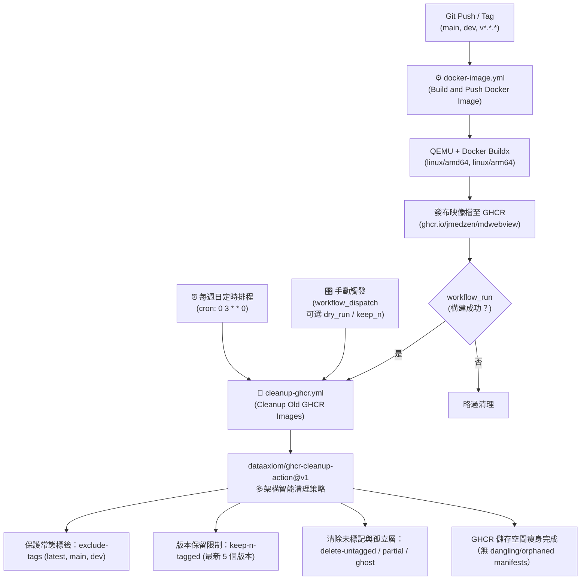

### 工作流程詳細說明

#### 1. 容器映像檔構建與發布 (`.github/workflows/docker-image.yml`)
- **觸發條件**：
  - Push 至 `main` 或 `dev` 分支
  - 發布符合 SemVer 規範的 Git Tag（`v*.*.*`）
  - 手動 `workflow_dispatch`
- **架構特點**：
  - 透過 QEMU 與 Docker Buildx 進行跨架構原生編譯，產出 `linux/amd64` 與 `linux/arm64` 雙架構映像檔。
  - **Tagging 策略**：
    - `main` 分支對應 `latest` 與 `main` 標籤。
    - `dev` 分支對應 `dev` 標籤。
    - Git Tag 對應語意化版本號（如 `v3.6.0`、`3.6.0`）。
  - **快取機制**：採用 GitHub Actions 快取後端（`type=gha`），顯著縮短二度建置耗時。

#### 2. GHCR 舊映像自動修剪維護 (`.github/workflows/cleanup-ghcr.yml`)
- **解決挑戰**：
  - Docker 雙架構映像在 GHCR 中會以 Manifest List 索引多個子架構層（未標記的 untagged manifests）。
  - 若使用原生 API 或一般套件刪除工具，容易留下孤立的子架構層或誤傷有效映像。
- **採用技術**：`dataaxiom/ghcr-cleanup-action@v1`（專為 GHCR 與 Multi-Arch 設計）。
- **清理策略**：
  - **保留最新版本數**：`keep-n-tagged: 5`（預設保留最新的 5 個版本）。
  - **核心標籤豁免**：`exclude-tags: 'latest,main,dev'`，確保首頁部署與核心指標永不被刪除。
  - **深層清理**：啟用 `delete-untagged`、`delete-ghost-images`、`delete-partial-images` 與 `delete-orphaned-images`，徹底清除殘留的中間層與斷頭清單。
- **三重觸發**：
  1. **全自動流水線（`workflow_run`）**：在「Build and Push Docker Image」成功完成後無縫自動接續執行。
  2. **定時排程（`schedule`）**：每週日 UTC 03:00（台北時間 11:00）執行全面深度維護。
  3. **手動測試（`workflow_dispatch`）**：可手動執行，支援勾選 `dry_run`（僅預覽輸出將刪除的 Digest 清單而不執行真實刪除）與自訂保留數量。
- **權限容錯**：配置 `token: ${{ secrets.GHCR_PAT || secrets.GITHUB_TOKEN }}`，優先使用預設工作流程 Token，必要時亦可透過倉庫 Secret `GHCR_PAT` 擴充權限。

---

## 15. 前端高並發與競態防護設計

針對使用者快速連續切換大型經文、非同步搜尋以及長時間閱讀場景，前端 `app.js` 實作以下容錯守衛機制：

| 機制 | 實作位置 | 解決問題與架構細節 |
|------|---------|-------------------|
| **世代守衛 (Generation Guard, P1-9)** | `openFile` / `tryOpenVirtualFile` | 每次進入 `openFile` 自增 `state._openToken`。所有非同步 `await` 返回後及 DOM 置換前，檢驗 `token === state._openToken`。徹底防止點擊慢速未快取檔案 A 後立即點擊已快取檔案 B，造成 A 晚返回覆蓋 B 的競態破壞。 |
| **返回首頁全面失效** | `goHome()` | 於切換畫面**之前**即自增 `state._openToken` 並 `abort()` + 清空 `_openFileAbort`，使所有在途開檔（含無法真正中止的回應本文解碼階段）在後續 token 檢查時一律被丟棄，不會回頭改寫已隱藏的閱讀器或排程閱讀進度儲存。 |
| **虛擬分塊雙重識別檢查** | `ensureChunk()` / `teardownVirtual()` | 每個虛擬文件持有自己的 `abortController`；分塊請求帶上 `signal`，`teardownVirtual()` 時統一 `abort()`。且於 `await res.text()` **之後**再次檢驗 `state.virtual === v`，才允許建立/插入 DOM，徹底封堵「舊文件分塊插入新文件內容區」的競態窗口。 |
| **請求取消與假錯誤消除 (P1-10)** | `openFile` / `fetch` Catch | 連續點擊時主動觸發前次 `_openFileAbort.abort()`；`catch` 區塊首行加入 `if (err.name === 'AbortError') return;`，避免中斷請求在畫面短暫彈出「載入失敗」假錯誤。 |
| **快取內容重新驗證** | `openFile` / `cacheGet` | 不再直接回傳 LRU 快取；改以快取 ETag 發出條件式 `/api/render` 請求（`If-None-Match`），`304` 才掛載快取、`200` 以新內容取代，確保同一工作階段內檔案編輯即時反映；若快取本體已遭淘汰但 ETag 仍在，則清除 ETag 後重新無條件請求。 |
| **安全 URI 解碼 (P1-11)** | `safeDecodeURIComponent` | 檔案名稱含 `%` 或特殊跳脫符號時，避免直接呼叫原生 `decodeURIComponent` 丟出 `URIError` 中斷流程。 |
| **全域與頁內搜尋取消 (P1-15)** | `performGlobalSearch` / `doPageSearchVirtual` | 支援輸入清除或換詞時即時中止前次搜尋請求，釋放伺服器運算與網路頻寬。 |
| **二分搜尋消除排版卡頓 (P1-16)** | `saveReadProgress` | 避免在萬行經文中對每一行呼叫 `getBoundingClientRect()` 引發嚴重的 Layout Thrashing，改用已快取行號錨點執行二分搜尋（只需 10~15 次量測）。 |
| **大陣列展延堆疊防護 (P1-17)** | `buildVirtualTocItems` / `generateTOC` | 移除 `Math.min(...largeArr)`，改採單次迴圈遍歷，徹底防範大經文目錄深度觸發 RangeError: Maximum call stack size exceeded。 |
| **閱讀進度還原不干擾深度跳轉 (v3.7.6)** | `restoreReadProgress` / `isVirtualizedFile` | 先以 `isVirtualizedFile(data.filePath)` 早退（`dict:` 一律為真，否則比對 `LARGE_FILE_MIN_BYTES`），因為辭典檔永遠走虛擬路徑卻不在主樹 `state.fileSizes` 中，舊的「只看大小」判斷會誤判而補送絕對 `scrollTo`。兩個延遲計時器（150 ms 與 500 ms）各自以 **`openFile()` 之後**才捕捉的 token（`openFile` 本身會遞增 `state._openToken`）加上 `state.currentFile !== data.filePath` 為守衛，並於觸發時重新查詢 `#content` 元素。實測 A/B：舊守衛產生 2 次針對過期 `scrollTop` 的殘留捲動（停在 1234567），修正後為 0 次且正確還原；一般非辭典檔案兩種版本還原結果相同。 |
| **虛擬深度跳轉自我修正對齊 (v3.7.6)** | `scrollToLineVirtual` | 以「要求行」的 anchor 為 `scrollTarget`（非第一個 highlight），並以最多 4 次嘗試的對齊迴圈量測 `target` 與 `#content` 的相對位置、收斂至 ≤ 2 px，無進展即中止；守衛為 `state.virtual !== v`、`jumpToken = state._openToken` 快照與 `target.isConnected`。使用專屬 `v._lineJumpRaf`（不與 `setupVirtualScroll` 的 `v._scrollRaf` 節流閘門共用），`teardownVirtual()` 負責取消。 |
| **辭典分頁走訪失效守衛 (v3.7.6)** | `dictFulltextNextPage` / `runDictSearch` | 在途分頁請求以 `state.dictAbortController === controller` 判定所有權，回應落地前再比對 `state.dictFulltextCache === cache` 且 `cache.query` / `cache.files` 與送出時相符，否則直接丟棄（避免新查詢／新檔案集在途時被舊頁復活）；`state.dictFulltextCache` 於 5 處（空查詢、查詢詞變更、模式切換、單檔勾選、全選）與 `dictFulltextScrollTop` 一起重置。 |
| **Service Worker 離線回退 (P2-1)** | `sw.js` Fetch Handler | 當處於完全離線且快取未命中時，回傳明確的 HTTP 504 Gateway Timeout Response 而非丟出未處理的拒絕錯誤；安裝後發送 `SKIP_WAITING` 實現無縫即時生效。 |
| **Service Worker 同源快取隔離** | `sw.js` `activate` | 版本升級時僅刪除前綴為 `mdwebview-shell-` 與 `mdwebview-content-` 的舊快取，不再無差別清空 `caches.keys()`；同一 origin 上其他應用程式（或其他部署路徑）的快取得以完整保留。 |

---

## 16. CSS 樣式系統與響應式斷點設計

專案採用原生現代 CSS 變數（Custom Properties）與 Flexbox/CSS Grid 系統，樣式經過三階段重構進行了深度的語意化收斂，將原本散落各處的媒體查詢區塊整併為 **8 個區塊、7 組語意明確的核心斷點條件**，並消除無效死規則，確保 CSS 語法階層與大括號嚴格平衡。

### 16.1 媒體查詢斷點分層矩陣

| 斷點條件 | 定義區塊 | 核心職責與適用範圍 |
|---------|---------|-------------------|
| `@media (max-width: 768px)` | L2569 | **主要行動端佈局**：App Shell 轉為單欄、頁首緊湊化、左側目錄/搜尋/大綱抽屜化、全螢幕毛玻璃遮罩（Backdrop）、浮動查詞操作面板自適應、使用者偏好設定彈窗雙欄轉單欄流動佈局 |
| `@media (max-width: 600px)` | L6673 | **公告訊息彈窗**：專屬緊湊視窗適配，縮小 modal padding 與字型大小，按鈕轉為垂直流動排列以防溢出 |
| `@media (max-width: 520px)` | L2931 | **小型螢幕微調**：各類操作按鈕（font-size 調整、複製連結、查詞）縮減內距與邊框，避免在 5.5 吋以下手機出現橫向捲軸 |
| `@media (max-width: 480px)` | L2947 | **極窄手機體驗**：頁首標題自動隱藏或省略（text-overflow）、彈窗關閉按鈕放大觸控熱區、各級標題字級動態縮減 |
| `@media (max-width: 360px)` | L2998 | **超微型裝置自適應**：針對極小手持設備（如 Galaxy Fold 封面螢幕）進行最後一哩字級微調 |
| `@media (max-width: 768px)` (Admin) | L3303 | **管理員後台專屬響應式**：後台面板轉為全螢幕覆蓋模式（100vw × 100vh）、流量分析與硬體圖表表格自動包裹水平滾動容器（`overflow-x: auto`）、系統設定表單轉為流動彈性網格 |
| `@media (max-width: 768px)` (Media) | L7259 | **媒體燈箱行動端工具列**：調整燈箱工具列與 `env(safe-area-inset-*)` 安全區域的相對位置，避開瀏海與虛擬 Home Indicator |
| `@media print` | L3005 | **列印與輸出格式**：隱藏全站導覽列、抽屜、懸浮按鈕、彈窗與背景裝飾；正文轉為高對比黑白排版與自動分頁控制 |

### 16.2 行動端佈局優化與品質保證準則

1. **雙抽屜互斥與單一焦點原則**：
   在 768px 以下行動端，左側檔案樹大綱抽屜與右側辭典抽屜嚴格互斥，展開任一側時自動收合對側並升起 z-index 85 毛玻璃遮罩，防止多層面板交疊導致操作錯亂。
2. **彈窗自適應與彈性流動網格**：
   偏好設定彈窗與後台管理彈窗在桌機端維持居中卡片式呈現（最大寬度 720px~960px）；在 768px 以下自動擴展為全螢幕或自適應 95% 寬度，按鈕群使用 `flex-wrap: wrap` 與 `gap` 排列，杜絕固定寬度破版。
3. **消除無效樣式與嚴格括號平衡**：
   重構過程中全面消除了歷史遺留的重複規則（如重複宣告的 `.seo-stats-box` 與 `.logo-text` 衝突），並由單元測試 `tests/test-css-theme.test.js` 與 `tests/test-mobile-layout-audit.test.js` 嚴格監控 CSS 語法閉合度與行動斷點完整性。

### 16.3 側邊欄拖曳調整寬度把手（v3.7.8）

桌機端左右兩側面板皆可拖曳邊緣調整寬度，各由一條獨立的 CSS 規則定義：

| 把手 | 規則 | 所在面板 | 拖曳範圍 |
|------|------|---------|---------|
| `#resizeHandle` | `.resize-handle`（§10） | 左側 `#sidebar`（檔案樹／搜尋／大綱） | 220–500px |
| `#dictResizeHandle` | `.dict-resize-handle` | 右側 `#dictSidebar`（辭典） | 240–560px |

兩者刻意維持**實作獨立**而非合併為單一規則，因為響應式行為互異：辭典把手在 768px 以下以
`display: none !important` 強制隱藏（行動端改走抽屜模式），左側把手則隨側邊欄一同隱藏。

視覺規格（v3.7.8 起，兩側一致）：

- 熱區寬度 **6px**；視覺指示條 **4px × 96px**、圓角 4px。
- 指示條平時 `opacity: 0`（不干擾閱讀），`:hover` 與拖曳中的 `.active` 才顯現。
- 顯示時套用 `background: var(--accent)` 與 `box-shadow: 0 0 10px var(--accent-dim)` 形成光暈，
  使把手在深／淺色主題下皆清楚可辨；五套主題各自帶入自身強調色。
- 高度由 32px 提升至 96px（3 倍），解決過往指示條過短、難以察覺此處可拖曳的可用性問題。
- 加大熱區**不影響**面板寬度運算：`setupResizeHandle()` / `setupDictResizeHandle()`
  以 `sidebar.offsetWidth` 為基準，未對把手寬度做任何硬編碼假設。

行動端（≤768px）與列印（`@media print`）皆完全隱藏把手，不提供拖曳調整（見 §16.1）。

### 16.4 首頁垂直溢出防護（v3.10.2）

**症狀**：iPhone 首頁最上方的蓮花 🪷 完全消失，且在畫面上任何方向的滑動都無法讓它出現。

**成因**：`.welcome-screen` 同時使用 `height: 100%` 與 `justify-content: center`。內容一旦超過容器高度，flex 置中會讓**上下兩端同時溢出**——下方溢出仍可向下捲動，但上方溢出落在捲動原點之上，該處沒有任何捲動空間，因此永遠搆不到。

這是 v3.10.1 安裝引導卡片（約 163px）造成的回歸：它把原本勉強塞得下的首頁推過了臨界點。

**實測數據**（375×667，模擬 3 項推薦清單 + 安裝卡片顯示）：

| 項目 | 修前 | 修後 |
| :--- | ---: | ---: |
| 內容總高 | 702px | 819px |
| 容器可視高 | 619px | 619px |
| 蓮花 `top` | **−33px** | **66px** |
| 被裁切高度 | 81px | 0px |
| `scrollTop = 0` 後 | 仍為 −33px | 正常可見 |

修後於 375×667、390×844、393×852 三種尺寸驗證，蓮花 `top` 分別為 66 / 64 / 72px，均完整可見且容器可正常捲動。

**修法**：

```css
.welcome-screen {
  min-height: 100%;      /* 原為 height: 100% */
  padding: 24px 16px;
  box-sizing: border-box;
  justify-content: center;   /* 保留，內容較矮時仍置中 */
}
```

改為 `min-height` 後，容器高度隨內容成長，溢出交給父層 `.content` 的 `overflow-y: auto` 處理；內容較矮時置中效果完全不變。

**防護措施**：`tests/test-welcome-overflow.test.js`（4 項）斷言 `.welcome-screen` 不得使用 `height: 100%`、必須使用 `min-height: 100%`、保留置中，並確認安裝卡片位於 `#welcomeScreen` 內以隨首頁一起捲動。測試的失敗訊息直接寫明後果，避免後人以「看起來比較簡潔」為由改回固定高度。

> ⚠️ 同類陷阱：任何 `display: flex` + 固定高度 + `justify-content: center` 且內容可能超出的容器，都有相同的「頂端不可及」問題。此類容器應改用 `min-height`，或改用 `justify-content: safe center`（需留意瀏覽器支援度）。

---

## 17. PWA 安裝引導（v3.10.1）

讓使用者知道可以把站台「加到手機桌面」。設計原則是**不在第一次造訪就打擾**，且任何提示都必須有禮貌的退出方式。

### 17.1 顯示時機

同時滿足以下條件才會出現首頁安裝卡片：

| 條件 | 判斷依據 |
| :--- | :--- |
| 不是獨立視窗模式 | `isStandaloneMode()`：`matchMedia('(display-mode: standalone)')` 或 `navigator.standalone === true` |
| 尚未安裝 | `localStorage` 無 `mdWebview-install-done` |
| 未被暫時婉拒 | 距上次「以後再說」超過 3 天（`mdWebview-install-dismissed`，常數 `INSTALL_SNOOZE_DAYS`） |
| 已建立使用意圖 | `recentFiles.length >= 2` **或** 存在 `LAST_READ_PROGRESS.filePath` |

「已建立使用意圖」是核心門檻：讀過至少兩篇、或至少有一篇讀到一半，才代表這人真的在用，此時建議安裝才有意義。

**靜默期為何是 3 天**

`INSTALL_SNOOZE_DAYS = 3` 是產品決策，集中宣告於 `app.js` 的 §17 區塊開頭；`isInstallSnoozed()` 與測試皆引用此常數，避免天數散落多處失去同步。

原本定為 30 天，但那對多數讀者等同「永遠不會再看到」，安裝率被壓得過低。3 天大致涵蓋一次連續閱讀的節奏，過了就換個時機再提一次；若使用者仍不需要，第二次婉拒後態度已明確，此時再拉長也無意義。

### 17.2 平台分流

| 平台 | 行為 |
| :--- | :--- |
| Chromium（Android／桌機） | 攔截 `beforeinstallprompt` 存入 `_deferredInstallPrompt`，按下安裝時呼叫 `prompt()` |
| iOS／iPadOS | Safari 不支援 `beforeinstallprompt`，改顯示三步驟圖文教學 Modal |
| 已安裝 | 所有提示永久停用，設定入口也一併隱藏 |

iPadOS 的判定需特別處理：其 UA 與 macOS Safari 相同，因此額外檢查 `navigator.platform === 'MacIntel' && navigator.maxTouchPoints > 1`。

### 17.3 三個入口

1. **首頁卡片**：`#installCard`，位於 `#welcomeScreen` 內，隨首頁一起捲動。
2. **圖文教學 Modal**：`#installGuideOverlay`，三個步驟各帶行內 SVG 圖示。
3. **設定常駐入口**：`#installSettingsSection`（閱讀紀錄分頁），永久保留，讓改變主意的使用者隨時找得到。

### 17.4 兩個實作陷阱

**`.install-card[hidden]` 需要 `!important`**

`.install-card` 使用 `display: flex`，會覆蓋 `[hidden]` 的預設 `display: none`。因此必須明寫：

```css
.install-card[hidden] { display: none !important; }
```

**文案避開技術術語**

使用者不需要知道「PWA」、「Service Worker」、「離線快取」。卡片只說「加到手機桌面，點一下就能讀」。

### 17.5 測試

`tests/test-pwa-install-prompt.test.js`（23 項）涵蓋：卡片與 Modal 結構、三步驟與行內 SVG（禁止外部 ``）、`hidden` 預設值、「以後再說」寫入 3 天（並鎖住 `INSTALL_SNOOZE_DAYS === 3`）、iPadOS 判定、iOS 走教學 Modal、Chromium 攔截 `beforeinstallprompt`、`appinstalled` 事件、`setupInstallPrompt()` 於 `init()` 內被呼叫、`goHome()` 觸發卡片、`.install-card[hidden]` 的 `!important`、`prefers-reduced-motion` 支援。


---

## 18. 為何 app.js / server.js 不做模組化重構

v3.10.4 曾完整評估「把過長的 `app.js`（11,300 行）與 `server.js`（5,600 行）分段抽成 `lib/` 模組」。結論是**不建議**，原因如下，記錄於此以免日後重複評估。

### 18.1 量測結果

以作用域分析逐函式計算對全域狀態的依賴（已排除 `fs`/`path`/`os`/`http` 等原生模組）：

| 檔案 | 行數 | 頂層函式 | 頂層綁定 | ≥40 行函式的平均全域依賴 |
| :--- | ---: | ---: | ---: | ---: |
| `app.js` | 11,296 | 246 | 66 | —（單一閉包，無法分割） |
| `server.js` | 5,640 | 86 | 231 | **6.0 個** |

### 18.2 app.js：結構上不可分割

`app.js` 是**單一 IIFE**，246 個函式共用同一個閉包，包含 `state`、`storage`、`$`、`showToast`、`escHtml`、`apiFetch` 等 66 個頂層變數。要抽出任何區塊，必須把這些依賴逐一參數化——等同重寫整個檔案。

| 候選區塊 | 行數 | 實際耦合 |
| :--- | ---: | :--- |
| §21 Admin Panel | 2,419 | `state`×40、`showToast`×37、`escHtml`×35、`storage`×12 |
| §6.5 Media Lightbox | 354 | `state`×79（跨 26 個欄位）、`showToast`×17 |
| §6 Markdown Viewer | 1,748 | 虛擬化引擎，與 §8 TOC、§9 搜尋共用節點 |

此外，`lib/` 是**後端專用慣例**（10 個模組全部 `module.exports`），瀏覽器端無法 `require()`。前端唯一可行的跨檔模式是像 `i18n/search-variants.js` 那樣掛 `window`，但會引入全域命名衝突與載入順序依賴。

**替代方案**：`app.js` 於 v3.10.4 修正了失真的區塊標記（見 §9.1 與下表），使 11,300 行的檔案可正確導覽，而不必承擔重寫風險。

### 18.3 server.js：沒有低耦合的大型區塊

原本的評估假設可抽出 4 個大區塊（約 3,038 行）。實際量測後全數推翻：

| 原目標 | 原估依賴 | 實際依賴 | 判定 |
| :--- | ---: | ---: | :--- |
| `getSystemHardwareStats` | 1 | **24** | 是聚合器，非獨立模組 |
| `buildSearchIndexAsync` | 3 | **16** | 與索引狀態深度綁定 |
| `listenWithFallback` | 1 | **16** | 依賴啟動期設定 |
| `handleAnalyticsExport` | 3 | **20** | 依賴 analytics 全套狀態 |
| `getSectionIndex` | 2 | **11** | 依賴三層快取狀態 |

`getSystemHardwareStats` 是最典型的例子：它讀取 `searchIndex`、`dictIndex`、`httpMetrics`、`sessions`、`searchMetrics`、`sectionIndexMetrics`、`workerPool` 等約 20 個全域狀態並組成單一回應物件。抽到 `lib/` 需注入全部依賴，反而比留在原處更難維護。

真正無狀態的只有 4 個小工具函式（`getDockerMemoryLimit`、`getDirSizeAsync`、`getCpuUsagePct`、`isDockerContainer`），合計 76 行、佔 1.4%，抽取收益不足以合理化改動。

### 18.4 已完成的替代改善

既然「搬程式碼」不可行，改為修正**失真的區塊標記**（純註解，零行為變更）：

| 檔案 | 問題 | 修正 |
| :--- | :--- | :--- |
| `app.js` | §6.5 標記涵蓋 1,668 行，但燈箱程式碼僅 354 行；其後 1,327 行是 `setupEventListeners()` | 將事件綁定獨立為 §20，§6.5 縮回 354 行 |
| `app.js` | §21 單一標題涵蓋 2,419 行、44 個函式 | 細分為 §21.1–§21.6 六個子群並建立索引 |
| `app.js` | 頂部索引缺 §6.5、§16.5、§18.5 | 補齊並標註非遞增順序 |
| `server.js` | §19 標記涵蓋 557 行，但硬體程式碼僅 291 行；其後是 8 個 admin handlers | 拆為 §19（工具）、§19 (續)（聚合器）、§19.5（admin 維護） |
| `server.js` | §12 標記僅 18 行（只有狀態常數），函式本體在 500 行之後 | 標記為「狀態與常數」，並在函式本體處補 `§12 (續)` |

修正後，兩個檔案的所有區塊標記**與實際內容一致**，且 `git diff` 確認零程式碼變更、406 項測試全數通過。

### 18.5 若日後仍需縮短檔案

唯一可行路徑是**架構級重構**：把 20 多個全域狀態收進單一 `AppContext` 物件，再按功能切分模組。代價是改動幾乎整個 `server.js`、13 個 server 測試需重寫、風險集中於全站唯一入口。建議在有大規模功能變更時一併進行，而非單獨為「縮短檔案」而做。

---

## 19. 使用者帳號（v3.12.6）

線上網站（`MDW_DEPLOY_TARGET=web`）才有帳號；單機模式不開資料庫，維持本機免登入。

### 19.1 資料與 session

- 帳號存在 `users.db`（預設與 `config.json` 同目錄，`USERS_DB_PATH` 可改），用 Node 內建 `node:sqlite`，不加依賴。結構版本記在 `PRAGMA user_version`，遷移只加不減，所以退回舊映像仍能啟動。
- 密碼用 scrypt（N=2^17, r=8, p=1）存成 `$scrypt$ln=17,r=8,p=1$salt$hash`。舊 `config.json` 管理員的 PBKDF2 憑證在第一次登入時搬進 `users` 表並改存 scrypt；`config.json` 的 `admin` 欄位保留一個版本以便退版。
- Session token 放 HttpOnly cookie，資料庫只存 SHA-256。一般使用者 30 天、管理員 7 天沒使用才過期，每 5 分鐘最多寫一次 `last_seen_at`。登入、重設密碼、改密碼都會換新 token 或登出其他裝置。
- `X-Admin-Token` 標頭仍可帶 session token（`/api/admin/login` 的回應附 token），給命令列工具與測試用；帶標頭的請求不會被跨站偽造，沿用寬鬆同源規則。瀏覽器一律走 cookie，會改資料的 cookie 請求必須通過嚴格同源檢查並使用 JSON。

### 19.2 防濫用

| 項目 | 規則 |
| :--- | :--- |
| 登入 | 同一帳號連續失敗 5 次後鎖 1、2、4… 分鐘（最多 15）；同一 IP 15 分鐘 20 次失敗暫停；設定 Turnstile 時失敗 3 次後要人機驗證 |
| 註冊 | 隱藏欄位、填表少於 2 秒、Turnstile、每 IP 每小時 3 次、全站每小時上限（後台可調）、拒絕的信箱網域 |
| 寄信 | 每個信箱每小時 3 封、每 IP 每小時 10 封；回應一律相同，不洩露帳號是否存在 |

### 19.3 條款頁面

寄信（`MAIL_PROVIDER`、`MAIL_API_KEY`、`MAIL_FROM`）與 Turnstile（`TURNSTILE_SITE_KEY`、`TURNSTILE_SECRET_KEY`）的值由 `lib/integrations.js` 提供：環境變數有值就用環境變數（後台顯示為鎖定），否則用後台網頁填寫、存在 `app_settings` 的 `integrations.*`。金鑰類以 AES-256-GCM 加密，金鑰檔是資料庫旁的 `secrets.key`（600，第一次儲存時產生；記憶體資料庫用行程內金鑰）；解不開時視為未設定並提示重填。API 只回傳末四碼。

第三方登入（`lib/oauth.js`）的金鑰也走同一套：Google（Client ID、secret）、Facebook（App ID、secret）、Apple（Services ID、Team ID、Key ID、私鑰）各欄位由 `integrations.get()` 取值（環境變數優先；Apple 私鑰另可用 `APPLE_PRIVATE_KEY_PATH` 指到檔案，優先順序為 環境變數內容 → 網頁設定 → 檔案）。每家另有開關 `oauth.<provider>.enabled`（沒設定過視為開啟，與舊行為一致）；登入畫面與入口只認「金鑰齊全且開關開著」（`oauth.isEnabled()`）。`POST /api/admin/auth-providers/settings` 先驗欄位格式（Google Client ID 結尾、Facebook App ID 純數字、Apple Team／Key ID 10 碼、私鑰必須是 EC 私鑰），再用「假授權碼換 token」向服務商確認金鑰（Google／Apple 回 `invalid_client` 拒絕儲存、`invalid_grant` 通過、`redirect_uri_mismatch` 提醒回調網址沒登記；Facebook 用 client_credentials），不會消耗任何真實登入；若會讓目前這位沒有密碼的管理員失去所有登入方式就拒絕（`WOULD_LOCK_OUT`）。`POST /api/admin/auth-providers/check` 用已存的金鑰再確認一次。

後台「🔑 帳號系統」的「開站設定」列出六步：對外網址、連接 Resend、寄測試信、設定 Turnstile、實際通過一次 Turnstile、開啟第三方登入（後兩步與 Turnstile 兩步是選用；`setupProgress()`，前三步是開放註冊的必要條件，未完成時分頁上亮紅點；第一次建立管理員後直接打開這個分頁）。`POST /api/admin/mail/settings` 先用 `GET https://api.resend.com/domains` 驗金鑰（200＝完整權限並比對寄件網域狀態、401 `restricted_api_key`＝只能寄信、其他 401／403＝拒絕儲存）；`POST /api/admin/turnstile/settings` 先送假 token 給 siteverify 驗 secret（`invalid-input-secret` 拒絕儲存）。兩者都要 10 分鐘內重新驗證過身分，連不上外部服務時照存並提醒。`POST /api/admin/turnstile/verify` 讓管理員在後台實際完成一次 Turnstile，伺服器以目前的金鑰驗證並比對網域。寄信卡片另有寄件網域的 DNS 檢查（`GET /api/admin/mail/dns`）：必要的是 DKIM（`resend._domainkey` TXT）與「寄信授權」（`send` 子網域有指向 `*.rmta.net` 的 CNAME，或舊版的 `v=spf1 include:amazonses.com` TXT，兩種都認），DMARC 選用。Resend 只開寄信時沒有 MX，所以不檢查 MX；有 `send` 的 CNAME 但缺 `rsend` 時只提醒。金鑰有完整權限時另外顯示 Resend 自己回報的網域驗證狀態，寄信專用金鑰查不到就只看 DNS。

隱私權政策與使用條款的文字存在資料庫的 `app_settings`（不放在程式碼），由後台「🔑 帳號系統」編輯，發布在 `/privacy` 與 `/terms`。勾選「重大變更」時，已註冊者下次登入要重新同意。

### 19.4 尚未包含（下一階段）

- 書籤、閱讀進度與偏好的跨裝置同步（資料表已建立，API 尚未開放），以及登出時清除本機資料。
- Apple 刪除帳號時的 token 撤銷。


### 後台區塊狀態燈與收合（v3.12.7）

後台每張 `.config-card[data-card]` 的標題前有一顆狀態燈（`.status-light`：綠 ok、黃 warn、紅 bad、灰 off＝沒有需要監控的狀態），標題旁有一行簡短說明（同時是燈的 tooltip），最右側有展開／收合箭頭，收合狀態存在 `localStorage['mdwebview.adminCollapsed']`。`enhanceAdminCards()` 補上這些元素；燈號由 `setAdminCardLight(key, level, text, part)` 設定，同一張卡片有多個 `part` 時取最嚴重的（例如「帳號資料庫與備份」同時看資料庫與備份）。「系統設定／搜尋優化」兩個分頁的燈從表單欄位即時計算（`refreshAdminConfigLights()`），「使用者」「帳號系統」兩個分頁的燈在各區塊載入或儲存後依 API 回傳的真實狀態更新。新增區塊時在 `index.html` 的 `.config-card` 加 `data-card="key"`，再於對應的載入函式呼叫 `setAdminCardLight`。

### 成功／錯誤訊息的主題色（v3.12.8）

每個主題都定義 `--success`、`--success-bg`、`--danger`、`--danger-bg`。`.form-success`、`.form-error`、`.diagnose-result`、`.setup-result.error`、`.danger-btn`、`.logout-btn` 都改用這組變數：訊息本文一律是 `--text-primary`，綠／紅只用在邊框、左側色條、圖示與短字，所以淺色、深色、禪意（米色）主題都看得清楚。註冊、重寄驗證信、忘記密碼送出後，登入卡片會整張換成 `#accountAuthDone`：寄到哪個信箱、接下來三個步驟、沒收到怎麼辦，以及「知道了／重寄驗證信／回到登入」。後台產生的邀請碼顯示在 `.invite-new`，大字等寬，附「複製」按鈕。

### 右上角整合選單（v3.12.9）

原本右上角的「繁／简」、帳號、齒輪三顆按鈕合成一顆 `#userMenuBtn`，右上角只剩搜尋、辭典（有啟用時）與這顆選單。按鈕外觀：已登入顯示名字首字（`.signed-in`），網頁版未登入顯示人形，單機版或帳號系統不可用時顯示齒輪（`.no-accounts`）。點開 `#userMenuPanel`：帳號狀態（未登入有「登入／註冊」，登入後顯示名字、Email 與「管理員」標籤）、繁體／简体、五個主題色塊、偏好設定、我的帳號、後台系統設定（管理員；單機版顯示為「系統設定」）、登出。`updateUserMenu()` 在登入狀態或部署模式改變時更新選單，任何時候呼叫都安全；繁簡與主題分別由 `updateUserMenuScript()`、`updateUserMenuTheme()` 跟 `applyDisplayScript`／`applyTheme` 同步。Esc、點選單外面會關閉，上下鍵在項目間移動。舊的「管理員登入」視窗（`#adminLoginOverlay`）已移除：所有登入都走 `#accountAuthOverlay`；後台逾期或還原資料庫後呼叫 `openLoginOverlay()`，會以 `afterLogin: 'admin'` 開帳號登入，管理員登入後直接回到後台。`/api/admin/login` 仍保留給命令列工具。
